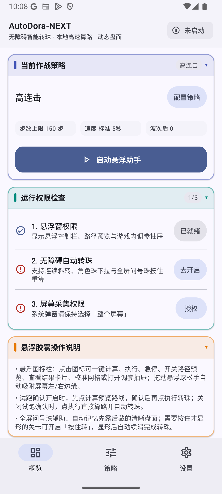
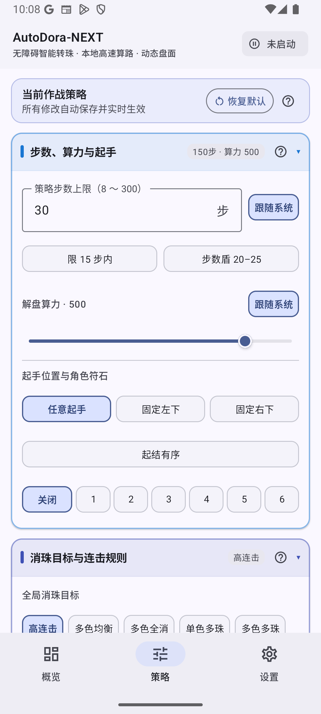
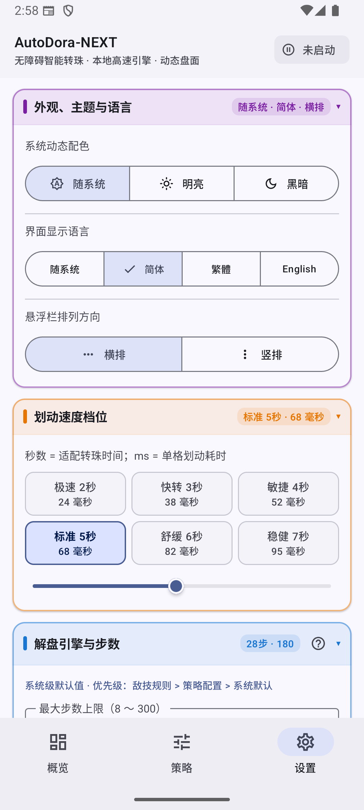
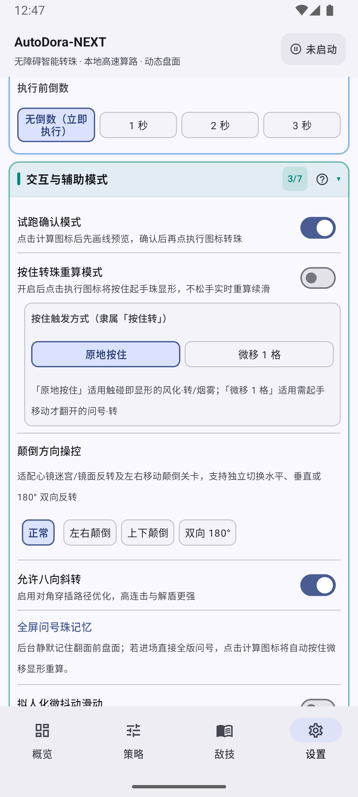
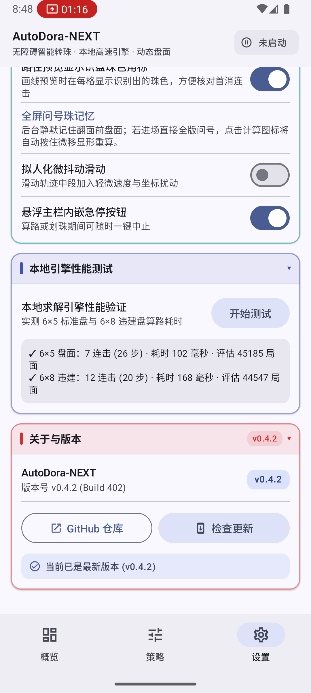
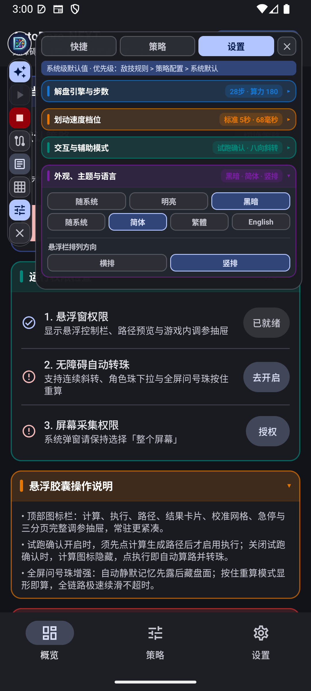
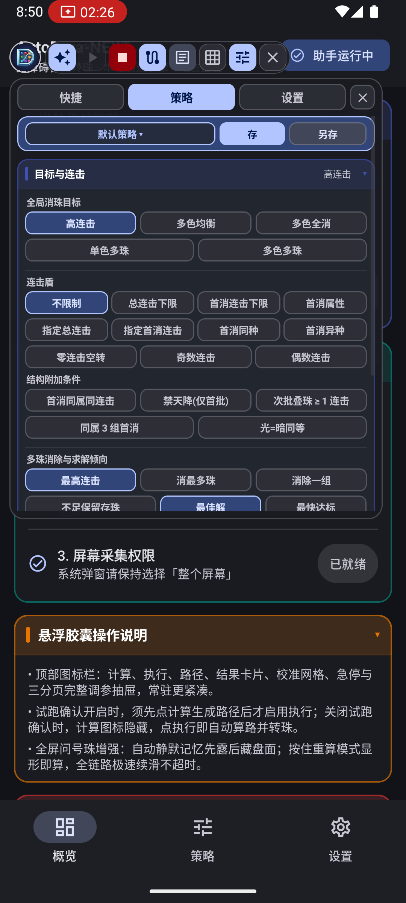
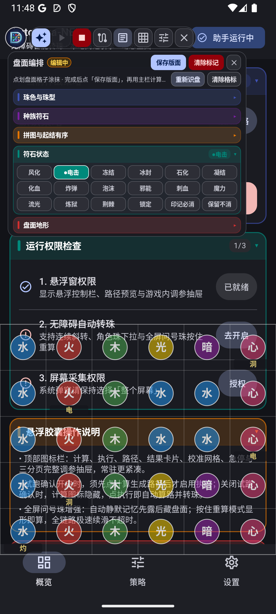
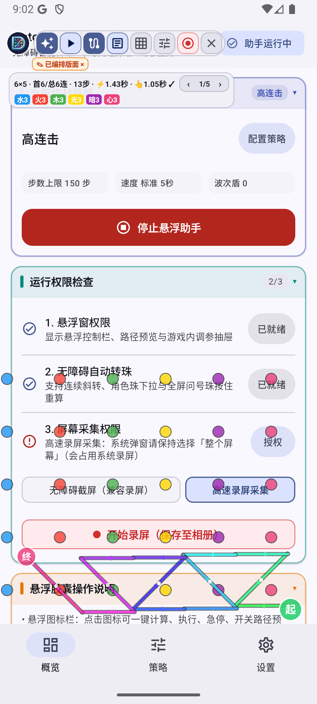

# AutoDora-NEXT

> **面向《神魔之塔》（Tower of Saviors）13 年全机制演进与现代 Android 设备（Android 10 ~ Android 16+）的免 Root、动态棋盘自适应、全组合解盾、1:1 盘面编排、C++20 本地高速引擎驱动的新一代智能转珠辅助工程。**

[](https://github.com/CloverKing/AutoDora-NEXT/releases/tag/v0.4.7)
[-3DDC84.svg?logo=android&logoColor=white)](./android)
[](./solver-core)
[](#快速构建与测试)
[](#多语言主题与应用内更新)

---

## 应用界面一览

> 以下全部截图均直接采集自 Android 16 模拟器运行 `AutoDora-NEXT v0.4.7` 签名正式包（仅展示应用自身界面与演示编排版面，不含第三方游戏版权素材）。

### 主控台（3-Tab Material You 启动页 · 彩色分组抽屉）

| 概览（策略摘要 · 权限检查） | 统一策略工作台（6 色抽屉） | 设置（横竖排/靠左右 · 三语 · 6 档速度） | 辅助模式（按住触发 · 四态颠倒） | 引擎实测 & 应用内更新 |
| :---: | :---: | :---: | :---: | :---: |
|  |  |  |  |  |

### 游戏内悬浮交互（4 态磁吸矢量胶囊 · 单抽屉调参 · 单开盘面编排 · 实时路径预览）

| 竖排靠右 + 4 态热切设置 | 游戏内 3-Tab 悬浮调参面板（单抽屉手风琴） | 1:1 盘面编排（5 色单开互斥抽屉 + 实时网格） | 路径预览与消珠结果卡片（逐盾 `✓` 判定 + Top-5） |
| :---: | :---: | :---: | :---: |
|  |  |  |  |

---

## 核心功能详解

### 1. C++20 64-bit 高性能动态解盘内核（`solver-core`）

- **任意规格动态棋盘**：彻底打破 `6×5` 硬编码限制，原生支持 **`3×3` ~ `8×8`**（含标准 `6×5` 与主角/黑金 **`6×8` 违建扩版**），以 `uint64_t` 位掩码在单条 CPU 指令内完成障碍与地形碰撞判定。
- **超长步数与毫秒级算力**：步数上限支持 **`8 ~ 300` 步**，多线程 Beam Search（算力档位 `32 ~ 800`）单次返回 **Top-5 多样化候选方案**；模拟器实测 `6×5` 盘面约 `90–110ms` 出解、`6×8` 违建盘约 `170ms` 达成 `12+` 连击。
- **全量对照 98 项官方敌技 & 22 项符石状态（官方百科 20 项 + 百科外经典锁定/荆棘 2 项）& 7 大种族**：
  - **连击类**：高连击、最低总/首连击、首消属性组数（严格排除心珠）、固定总/首连击、奇/偶连击、次批叠珠连击、同属连击、任意 `2~6` 属连击相等、首消相同/不同种类盾（完整支持心符石通用）、禁天降（只能消除首批/寒之气）、0C 空转。
  - **属性、珠数与种族类**：二/三/四/五属/六色（支持天降叠珠或严格首消）、强化突破、**7 大官方种族符石盾（神/魔/人/兽/龙/妖/机械）**、首消数字盾、首消全版、首消全某属、符石禁咒（模拟层彻底不可消）、反首消叠珠、绝对禁消、回复颠倒、**单属性 6 色完整四列规则矩阵**（4×4 全 16 种消珠形态选择器：`默认 / 切3 / 2珠 / 4~9珠 / 横排 / 直排 / 十字 / L形 / T形 / 田字 / 全消` × 优先权 `普通 / 优先 / 保留` × 消除时机 `任意 / 首消 / 叠珠 / 禁消` × 最低消 `1~5消`，双端均内置 **`全矩阵重置`** 一键恢复默认）。
  - **拼图、形状与直排升华**：单/双拼图（严格不黏连 / 宽松 / 强化 / 指定属）、严格 5 粒单·双·三十字限 / T 字限 / L 字限、2×2 田字、第 `1~6` 直排独立升华（3/4/5 消/整列）。
  - **22 项符石状态（官方百科 20 项 + 锁定/荆棘 2 项）与盘面地形**：风化（避碰或可选撞除）、电击、冻结（未冻高优消）、冰封、石化 & 凝结（每波四邻至多解一重）、化血 & **经典锁定符石**（全波必消 / 全版 30 颗锁定时渐进最大化消除）、爆爆炸弹（零触碰扣血避让）、**荆棘符石 / 钢线符石**（可移可消但每触碰 1 次依敌攻扣血，默认 0 触碰严避）、泡沫（可移动 + 重力追踪四邻破裂）、邪恶能量 / 刺血 / 弱化（避消惩罚或硬禁消）、魔力符石（每消 `+3 Combo` 精确模拟）、流光符石、炼狱之火（绝对禁入）、印记必消 / 保留不消；地形完整覆盖燃烧、灼热（消除扣血可穿行）、黑洞 & 血浴（可穿行但禁止停手）、结界地形（仅首消有效）、碎裂、暴风、瘴气、轨迹燃烧/腐蚀、起结有序（绿/红漩涡）、角色符石通行与停放地形。
- **无互斥自由组合 + 逐盾实时核验**：所有规则解耦为可叠加的硬约束与软目标，结果卡片逐条回显每项波次盾的 **`✓` 达成 / `✗` 未达成** 状态灯号。

### 2. 免 Root 零拷贝采集与多帧融合 CV 识盘（`core-capture` + `core-vision`）

- **合规屏幕采集、零陈旧帧校验、防断流热重授与自动违建探测**：基于 Android 10–16+ `MediaProjection` 前台服务零拷贝取帧，彻底修复 HyperOS / Android 14–16 静止画面误触 `vd.resize()` 断流、初始化首帧丢弃与重授权异步 `onStop()` 误杀新会话竞态；**每次计算/按住重算/编排识盘前强制清空旧帧缓存并触发合成刷新（零陈旧帧门控）**，即使录屏工具抢占或系统静默冻结虚拟屏也不会错误拿上一回合旧盘面求解导致滑屏错位，系统静默中断时自动同步失效状态并支持概览页一键热重授权（无需强退应用）；配备全态血条锚定防误判（支持绿/珊瑚红/粉紫/青蓝血条 **以及 `1/584001` 空血暗槽 + 左侧红心徽章识别**，彻底杜绝空血队误判队伍头像为假 `6×6` 违建或「自动校准」误吸 Boss 血条），并严格过滤暖米色/全高活动横幅防非战斗误判。
- **真实游戏标定多帧融合识盘（18 项异常状态与盘面地形自动检出）**：
  - 6 属性精准 HSV 分类（自动排除右上角种族徽章与印记象限防偏色）；**7 大种族圆章几何特征识别**（兼容魔族暗底米金环与人类等全种族角标，同时精准过滤心珠右上高光实现 `0` 误报 `心族`）；多帧高光强化星芒、`?` 问号珠、白边护盾珠。
  - **全量明显符石状态自动识别（全 6 色笛卡尔积通用去色偏）**：**电击符石（`电`，支持闪光峰值与低亮弱电弧全 6 色双相检测、剥离电光还原底层珠色并豁免红绿灯误起手，永不误判为 `?`）**、**冻结（`冻`）与冰封（`冰`）颜色无关方形晶格检测（6 色全覆盖且与暗珠冰封清晰解耦，同时豁免木/火冻结误报红绿灯）**、**爆破炸弹（`炸`，中心红核+金属灰环+外缘底色还原）**、**邪恶能量（`邪`，放宽至光/心较亮暗化底珠通用）**、**炼狱之火（`狱`，洋红火环主导保护防底色干扰）**、**石化符石（`石`）**、**化血 / 全版 30 颗锁定符石（`血`）**、**荆棘符石（`棘`）**。
  - **盘面地形与盾框自动识别**：**燃烧地形（`燃`，去除光珠高亮偏置全 6 色通用，并收紧拼图金框至纯黄金色 `35°–64°` 彻底杜绝连续 `1×6` 燃烧横行/围城被误判为拼图盾）**、**血浴地形（`浴`）**、**碎裂地形（`碎`，优先区分于暴风雾气）**、暴风区域（`暴风`）、经典金色与现代金属拼图框、**起结有序 V4 识别**（24 角度外环绿芒扫描突破种族角标遮挡、火珠邻格红溢抑制与官方单点绿/红漩涡约束）；所有自动检出状态与地形均在路径预览层同步渲染高对比角标。
  - 结界地形兼容识别，以及非战斗活动列表（强制校验盘面上方血条隔离带，根除自身半透明记忆圆圈自激反馈循环）、关卡转场、`VICTORY` 结算画面与敌技详情弹窗的自动静默拦截，彻底消除非战斗残留浮动识别层。
- **全屏问号珠双模破局**：
  - **先露后藏记忆快照（`FlashRevealMemoryTracker`）**：后台静默锁定翻面前的清晰盘面，全版变 `?` 后自动透视叠画并直接求解。
  - **免 Root 按住重算（Hold-and-Replan）**：主开关 **「按住转珠重算」** 下设隶属触发子项——**「原地按住」**（适用触碰即显形的风化‧转/烟雾）与 **「微移 1 格」**（适用需起手轻移才翻开的问号‧转）；内置两项独立参数：**「按住显形等待上限（`240–900 ms`）」**（仅限翻牌动画超时，轮询显形即提前退出）与 **「按住显形后解盘时间上限（`0.15–3.5 s`，默认 `0.4 s`，双端快捷档 `0.3s / 0.6s / 1.2s / 2.0s / 3.5s`）」**——随预算自动放宽步数（最高 80 步）与算力宽度（最高 600）并修复单起点早期波束坍缩，配合心跳保活无缝续滑。

### 3. 免 Root 精准分段手势与 6 档统一速度（`core-touch`）

- **精准连续分段手势**：基于 `AccessibilityService` (`dispatchGesture` + `willContinue`)，将起手按稳、45° 对角斜转、首步防滑拐保护、长路径分段续接与终点停稳拆分为独立分段，杜绝系统匀速压缩导致的丢步或首消偏差。
- **6 档统一划动速度（启动页 & 悬浮抽屉 1:1 同步）**：

| 档位 | `极速 2s` | `快转 3s` | `敏捷 4s` | `标准 5s` | `舒缓 6s` | `稳健 7s` |
| :--- | :---: | :---: | :---: | :---: | :---: | :---: |
| **单格划动耗时** | `24 ms` | `38 ms` | `52 ms` | `68 ms` | `82 ms` | `95 ms` |
| **适用场景** | 2 秒极速转珠 / 速刷 | 3 秒紧迫限时关 | 中高速日常 / 高帧率机 | 默认均衡（推荐） | 复杂斜转稳健执行 | 低帧率或超稳防断触 |

> **说明**：上方 `2s ~ 7s` 表示适配常规 `25–30` 步盘面的目标转珠时间档位，下方 `xx ms` 为滑动穿过单个棋盘格的时间；亦可在滑杆上 `20–140 ms` 自由微调。

- **操控辅助与安全保护**：支持角色符石从头像列垂直下拉（下拉不计步）、拟人化微抖动、**双端统一四态「颠倒方向操控」（`正常 / 左右颠倒 / 上下颠倒 / 双向 180°`，适配心镜迷宫/镜面反转与左右移动颠倒关卡，在启动页设置与悬浮窗快捷/设置 1:1 同步）**、默认「试跑确认模式（先画线确认再点执行）」、倒数执行与主栏内嵌红色急停一键中止。

### 4. 紧凑悬浮胶囊、统一彩色抽屉与 1:1 盘面编排（`app` + `core-data`）

- **紧凑矢量悬浮栏（4 态布局 · 左右自动吸边 · 重启位置记忆）**：
  - 圆形 App 图标手柄（支持拖动、点击折叠/展开）+ 常驻 8 个高辨识度矢量图标：`✦ 计算` · `▶ 执行` · `■ 急停` · `〰 路径` · `▤ 结果卡片` · `▦ 校准网格` · `🎚 调参抽屉` · `✕ 关闭`。
  - 在启动页或悬浮抽屉「设置 → 外观、主题与语言」中可随时 1:1 同步热切 **排列方向（横排 / 竖排）** 与 **停靠侧（靠左 / 靠右）** 共 4 种形态：
    - **横排靠左**：App 图标居左贴边，主栏向右展开；**横排靠右**：App 图标居右贴边，主栏向左展开，折叠与展开单球均锁定右边缘不跳动。
    - **竖排靠左 / 靠右**：停靠左侧时次级面板向右侧并列展开，停靠右侧时向左侧并列展开并自动按剩余宽度缩放防裁切。
  - **左右磁吸与持久化记忆**：拖动圆形悬浮球松手后按中线自动平滑吸附至屏幕左/右边缘，并自动记忆排列方向、停靠侧与纵向高度，下次重启悬浮助手无缝复原原位。
- **双端统一配色抽屉 + 差异化展开体验**：
  - **启动页（概览 / 策略 / 设置）**：彩色边框可折叠抽屉，默认全部展开且支持同时多开，一览全局参数。
  - **游戏内悬浮面板（快捷 / 策略 / 设置）**：与启动页保持完全一致的模块配色，但每个分页采用**单抽屉手风琴互斥展开**（展开一项自动收起其余项），最大化保留游戏画面视野。
- **1:1 交互式盘面编排（打开即自动识盘 · 单开互斥彩色抽屉）**：
  - **打开自动实时识盘 + 一键「重新识盘」**：每次打开「盘面编排」（若未处于已保存版面态）将自动瞬时隐藏悬浮层、采集当前实时战斗画面并完整识别 30 格珠色、强化/种族与全部 18 项异常状态/地形自动预填，大幅省去重复手动涂色；工具栏同时提供独立 **`重新识盘`** 按钮，敌技变盘或随时需要刷新时一键重新抓取实盘。
  - 划分 **5 大彩色单开互斥抽屉**（`珠色与珠型` / `种族符石` / `拼图与起结有序` / `符石状态` / `盘面地形`）与置于色框外的独立 **`重新识盘`** + **`清除格标`** 工具；展开任意一组时其余 4 组自动收起（并在所属标题栏右侧保留当前激活画笔徽标），大幅缩减编排面板占屏高度，绝不遮挡战斗盘面与血条区。
  - 严格遵循官方机制：`绿色漩涡` 与 `红色漩涡` 保持单点互斥（不会误标多点），`角色通行` 与 `角色停放` 支持多格涂抹。
  - 编辑完成后点击右上角 **`保存版面`**，关闭编排层后直接点击主悬浮栏的 **`✦ 计算`** 与 **`▶ 执行`** 即可基于编排版面求解与执行（顶部同步展示 `已编排版面 ×` 徽章，随时一键退出编排态）。
- **单一实时作战策略 + 波次解盾叠加**：去除冗余的多策略库管理与切换，全局维护唯一一套实时生效并自动保存的作战策略（顶部提供一键 **`恢复默认`**），双端「单属性规则矩阵」开放全 16 种消珠形态 4×4 选择器、`1~5消` 起消门槛与 **`全矩阵重置`**，叠加 `39` 种参数化波次盾 Chip 随时一键清盾。

### 5. 多语言、主题与应用内更新

- **四套资源三语实时热切**：内置 **简体中文 / 繁體中文 / English / 跟随系统**（`557` 项面向玩家的纯终态文案词条 100% 四语言对齐），无需重启应用实时刷新主界面与悬浮窗。
- **Material You 双主题联动与暗色高对比适配**：支持 **跟随系统 / 明亮 / 黑暗** 三态，主控台与游戏内悬浮栏/调参面板/编排面板同步换肤，并对暗色模式下的「本波已启用解盾」激活条与彩色抽屉摘要徽章进行独立高对比度适配（彻底杜绝动态取色下浅底浅字问题）。
- **应用内双通道检更与自动安装**：在「设置 → 关于与版本」内置 GitHub 仓库入口与检查更新，采用 **`api.github.com` → `github.com/releases.atom` + `expanded_assets` 免限流自动降级双通道**（彻底规避共享 IP/代理环境下的匿名 API `HTTP 403` 限流）；发现新版本后点击 **「下载并安装」** 直接在 App 内流式下载 GitHub Release 安装包（自动跟随 CDN 重定向、实时 MB/百分比进度条、随时取消、旧缓存自动清理、`PK\x03\x04` 完整校验），下载完成自动通过 `FileProvider` 拉起 Android 系统安装器完成升级（若尚未允许「安装未知应用」，自动引导授权并在返回后无缝续接安装）。

---

## 核心文档

| 文档 | 内容说明 |
| :--- | :--- |
| [docs/ARCHITECTURE.md](./docs/ARCHITECTURE.md) | **v3.0 系统架构与分阶段规划手册**：动态棋盘、多帧 CV、C++20 求解引擎、悬浮交互、1:1 编排、应用内更新与 Phase 1–4 演进路线图 |
| [docs/TOS_COMPLETE_MECHANICS_CATALOG.md](./docs/TOS_COMPLETE_MECHANICS_CATALOG.md) | **《神魔之塔》13 年（2013–2026）全机制全景手册**：实时追踪全谱系敌技、特殊符石、地形与队伍机制的当前落地状态 |
| [docs/enemy_skill_audit.md](./docs/enemy_skill_audit.md) | **《神魔百科 · 敵人技能》98 项全量结构化审计报告**：逐项核验官方正/误示例与引擎落地详情 |
| [docs/runestone_status_audit.md](./docs/runestone_status_audit.md) | **全量 22 项「符石狀態」物理核验报告**（官方百科 20 项 + 百科外经典锁定/荆棘 2 项）：逐项核验物理细节、CV 标定与编绘画笔映射 |
| [docs/LEGACY_AUTODORA_ANALYSIS.md](./docs/LEGACY_AUTODORA_ANALYSIS.md) | 旧版 `AutoDora-V3.4.3.apk` 深度拆解与继承升级对照表 |
| [ml/README.md](./ml/README.md) | Phase 4 端侧多头轻量 CNN（LiteRT `.tflite`）训练与数据飞轮规划 |

> **标定与合规原则**：所有棋盘几何探测、视觉色域与特化识别标定均严格基于真实《神魔之塔》游戏画面实测验证；仓库内绝不包含任何受版权保护的第三方游戏截图、角色立绘或原始游戏素材。

---

## 仓库结构

```text
AutoDora-NEXT/
├── solver-core/                  # 纯 C++20 高性能解盘引擎（CMake，零 Android 依赖，3×3~8×8，最高 300 步）
│   ├── include/autodora/         # types.hpp, board.hpp, rules.hpp, simulator.hpp, evaluator.hpp, solver.hpp
│   ├── src/                      # 精确消除物理模拟、全机制解盾评估、多线程 Beam Search、Top-K 多样化筛选
│   └── tests/                    # 51 项 C++20 单元测试与多盾/违建/路径回放回归集
├── android/                      # Android 原生多模块工程（Kotlin 2.1 + Compose M3 + Hilt + Room + DataStore + NDK）
│   ├── app/                      # 3-Tab 启动台、圆形图标悬浮栏、3-Tab 单抽屉调参面板、1:1 盘面编排、应用内更新器
│   ├── core-model/               # 跨层不可变模型、两层 RuleComposer、ShieldVerdictEvaluator 逐盾核验器
│   ├── core-capture/             # MediaProjection 前台零拷贝采集、血条锚定 6×5↔6×8 自动规格探测
│   ├── core-vision/              # 多帧融合 CvBoardRecognizer、FlashRevealMemoryTracker 全屏问号记忆、Hybrid 推理接口
│   ├── core-touch/               # 免 Root AccessibilityService 分段手势、角色珠下拉、按住重算续滑、6 档速度与镜像反转
│   ├── core-data/                # DataStore 设置、Room 实时策略持久化、39 项 WaveShieldCatalog、98 敌技 & 22 符石状态目录
│   └── solver-jni/               # NDK/JNI 桥接（arm64-v8a / armeabi-v7a / x86_64，-O3 优化）
├── ml/                           # 端侧多头轻量 CNN 训练与 LiteRT 导出管线（Phase 4）
└── docs/                         # 系统架构、机制全景手册、百科审计规范与应用干净截图（docs/images/）
```

---

## 开发进度与版本里程碑

- [x] **Phase 1（`v0.1.0`）**：纯 C++20 `3×3~8×8` 64-bit 动态解盘引擎（支持最高 300 步）+ Android 多模块骨架 + JNI 跨平台编译。
- [x] **Phase 2 & 2.5（`v0.2.x` – `v0.3.x`）**：免 Root 零拷贝 `MediaProjection` + 血条锚定 `6×5`/`6×8` 实图精准标定 + 先露后藏问号记忆 + 免 Root 按住重算续滑 + 经典/现代拼图框、起结有序漩涡、暴风、化血、结界与 VICTORY 过滤 + 逐盾 `✓/✗` 实时判定 + 方向逆转镜像与首步防拐保护。
- [x] **Phase 3 & 3.5（`v0.4.0` – `v0.4.7` · 当前版本）**：
  - **全量 98 敌技 + 22 符石状态（官方百科 20 项 + 百科外经典锁定/荆棘 2 项）+ 7 大官方种族审计与引擎/CV/编排闭环升级**。
  - **Material 3 / Material You 3-Tab 启动页 + 同色系悬浮 3-Tab 单抽屉调参面板 + 4 态磁吸记忆悬浮栏**（横排靠左/横排靠右向左展开/竖排靠左/竖排靠右，松手左右平滑吸边并持久记忆停靠侧与纵坐标）。
  - **5 色单开互斥抽屉 1:1 盘面编排（打开即自动识盘 + 一键「重新识盘」）**（仅允许单一抽屉展开防遮挡 + 激活画笔标题徽标、单点互斥绿/红漩涡、多格角色通行/停放、18 项齐整符石状态画笔含荆棘/锁定、独立清除格标、「保存版面 → 主栏计算/执行」工作流）。
  - **HyperOS / Android 14–16 屏幕采集防断流、零陈旧帧门控与热重授权** + **空血 `1 HP` 暗槽血条锚定防假违建** + **非战斗悬浮自激拦截** + **18 项异常状态/地形自动 CV 识别与全 6 色笛卡尔积去色偏**（电击双相+底色还原、颜色无关晶格冻结/冰封、炸弹、邪能、炼狱、燃烧/血浴/碎裂、7 种族圆章 V3、起结有序 V4、石化、全版 30 颗锁定·化血、荆棘 + 跨机制防误判隔离）+ **精准 45° 斜转 `1.414×` 弧长计时** + **双端 1:1 统一四态颠倒方向操控 & 嵌套按住触发子卡片 & 可配按住显形后解盘时间（`0.15–3.5s`）** + **6 档统一速度（`2s~7s`）**、**单一自动保存策略（一键恢复默认）+ 16 形态×`1~5消` 单属性规则矩阵（一键全矩阵重置）+ 暗色模式高对比度适配**、**三语纯终态文案热切（557 词条）** 与 **免 403 限流双通道检更 + 应用内流式下载与 `FileProvider` 自动安装**。
- [ ] **Phase 4（规划中）**：端侧多头轻量 CNN（LiteRT `.tflite` 热加载，攻克黑白符石/复杂联名皮肤/叠加态自动识盘）、纠错样本本地采集飞轮、端侧敌技说明自动解析与可选 Shizuku 触控引擎。

---

## 快速安装、构建与测试

### 1. 直接安装预编译 APK

前往 [GitHub Releases](https://github.com/CloverKing/AutoDora-NEXT/releases) 下载最新签名安装包（如 `AutoDora-NEXT-v0.4.7-release.apk`），安装后：
1. 在「概览 → 运行权限检查」依次授予 **悬浮窗**、**无障碍自动转珠** 与 **屏幕采集（选择「整个屏幕」）** 三项权限；
2. 若在 Android 13+ / HyperOS / One UI / ColorOS 遇到无障碍开关受限，按概览页「无障碍受限设置指引」点击「应用详情 → 右上角 `⋮` → 允许受限设置」后即可开启；
3. 后续版本可直接在 App 内「设置 → 关于与版本 → 检查更新 → 下载并安装」一键原地升级。

### 2. C++20 解盘引擎单元测试（51/51）

```powershell
powershell -ExecutionPolicy Bypass -File solver-core/run-tests.ps1
```

### 3. Android 全模块 JVM 单测（63/63）与 APK 构建

```powershell
# 运行全部模块单元测试并构建 Debug APK
powershell -ExecutionPolicy Bypass -File android/build-android.ps1 :core-model:test :core-capture:testDebugUnitTest :core-vision:testDebugUnitTest :core-touch:testDebugUnitTest :app:testDebugUnitTest :app:assembleDebug

# 构建签名 Release APK
powershell -ExecutionPolicy Bypass -File android/build-android.ps1 :app:assembleRelease
```
