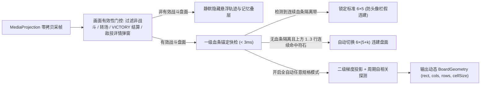
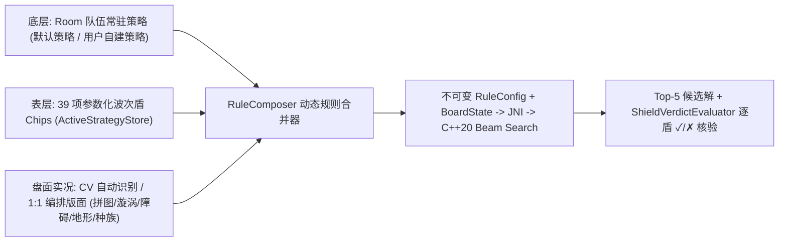
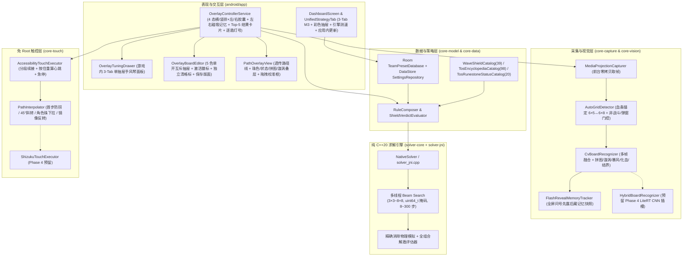

# AutoDora-NEXT v3.0 系统架构、功能设计与演进规划

> **当前基线版本**：`v0.4.7`（`versionCode = 407`，`minSdk = 29` / `targetSdk = 35`，Android 10 ~ Android 16+）  
> **项目定位**：面向《神魔之塔》（Tower of Saviors）13 年全机制演进与现代 Android 设备的**免 Root、全规格动态棋盘自适应、可自由组合解盾、问号/按珠变盘双模破局、1:1 实时盘面编排、C++20 端侧高速引擎驱动**的新一代智能转珠辅助工程。  
> **设计基线**：全面继承并升级旧版 [AutoDora-V3.4.3](./LEGACY_AUTODORA_ANALYSIS.md) 经实战验证的悬浮窗交互、调参与「问号‧转/风化‧转」按珠重算精华；完整对照 [《神魔之塔》13 年全机制全景调研手册](./TOS_COMPLETE_MECHANICS_CATALOG.md)、[98 项官方敌技审计报告](./enemy_skill_audit.md) 与 [20 项官方符石状态核验报告](./runestone_status_audit.md)。  
> **标定与合规原则**：所有棋盘几何探测、校准基准与视觉特征阈值均严格以**真实《神魔之塔》游戏画面**实测标定；仓库仅包含工程代码、结构化技术规范与应用自身纯净截图，严禁提交任何第三方版权游戏素材。

---

## 1. 动态棋盘规格与自动探测架构（`core-capture` + `solver-core`）

### 1.1 支持的棋盘规格

| 规格类型 | 尺寸 (`Cols × Rows`) | 格数 | 触发场景与几何特征 |
| :--- | :--- | :---: | :--- |
| **标准盘面** | **`6 × 5`** | 30 | 游戏常态核心战斗盘面（6 直行 × 5 横行）。 |
| **扩版盘面（违建）** | **`6 × 8`**（主力） 兼容 `6 × 6` / `6 × 7` | 36–48 | 主角【界限突破】、合作角色及黑金上滑扩行。左右边界、底边与 `cellSize` 保持不变，在标准 `6×5` 正上方直接**向上延伸 1–3 行**。 |
| **任意动态矩形** | **`3 × 3` ~ `8 × 8`** + 局部失效格掩码 | ≤ 64 | 适配暴风/碎裂/冰封造成的等效缩盘、特殊活动关或未来新规格棋盘。 |

### 1.2 引擎底层：64-bit 位掩码动态网格

- `solver-core` 彻底消除硬编码 `6×5` 常量，所有棋盘结构参数化为 `(cols, rows)`（`3 ≤ cols, rows ≤ 8`，最大 64 格）。
- 全部空间状态掩码（拼图 1/2、起结有序绿/红漩涡、角色通行/停放、燃烧、灼热、黑洞/血浴终点禁停、结界、碎裂、暴风、瘴气、禁止踏入等）均采用 **`uint64_t` 单字位掩码**表示，单条 CPU 位运算指令即可完成整盘碰撞与条件判定，零动态内存分配。

### 1.3 两级棋盘规格探测与画面门控管线（`AutoGridDetector`）

- **血条锚定防误判与 HyperOS 防断流热重授 / 零陈旧帧门控**：在 `base.topPx` 上方检测绿色/珊瑚红（严格限定红粉紫 `H ≤ 22° || H ≥ 295°` 且附纵向薄条校验，拒绝暖米色/全高活动横幅）/青蓝 HP 血条隔离带，**以及 `1/584001` 空血暗槽 + 左侧红心徽章**；命中时严格锁定 `6×5`，杜绝把队伍 6 个彩色头像误判为第 6 行假违建或「自动校准」误吸 Boss 血条。`MediaProjectionCapturer` 与 `ScreenCaptureSession` 通过 `released` 首帧零丢弃门控、静止画面零扰动（移除按帧龄误触 `vd.resize()`/`setSurface()`）、10 秒冷却受控恢复、`clearIfCurrent()` 身份校验防异步 `onStop()` 误杀新会话、失效自动清理并同步主界面状态以及概览页 `allowAlwaysClick` 一键热重授，彻底杜绝 Android 14–16 / HyperOS 假就绪与重授权失效；同时在 `startCaptureAndSolve` / `startHoldAndReplanExecution` / 编排识盘触发前**强制执行 `clearCachedFrame()` + 合成刷新门控**（后台监听同步跳过 `lastFrameAgeMs > 4000ms` 的陈旧帧），杜绝录屏冲突或系统静默暂停虚拟屏时误用上一回合旧盘面解盘导致滑屏结果与计算不符。
- **实时视觉校准框**：主悬浮栏点 `▦` 随时开启可拖拽四角/四边的半透明校准框，并附带 `上 / 下 / 窄 / 宽 / 高- / 高+ / 自动 / 重置` 像素级微调条，按比例持久化至 DataStore。

---

## 2. 视觉识别、记忆快照与 1:1 盘面编排闭环（`core-vision` + `app`）

### 2.1 多帧融合真实游戏 CV 识盘（`CvBoardRecognizer`）

针对电击闪电、燃烧火焰、拼图流光、强化星芒与红绿灯漩涡的闪烁动画特性，采集层支持 `1~3` 帧短间隔多帧融合（默认 2 帧），使用零全屏拷贝的 `DirectBitmapVisionFrame` 稀疏坐标直采，完成以下要素识别：

1. **6 属性基础珠色分类**：按真实神魔 HSV 色域标定（暗 `248°–316°`、心 `316°–346°` 等），采样环**严格避让右上象限**（杜绝种族黑白徽章与四类敌技印记干扰原色）。
2. **珠型、异常符石状态与盘面地形自动识别（18 项实测 0 误报 CV 检出）**：
   - **强化符石（`+`）**：多帧高光峰值星芒特征；
   - **种族徽章提示（V3 圆章几何）**：在右上角 `[0.28r..0.78r]` 执行 `7×7` 采样，联立检验暗色圆章内核、外半区白/米金圆环（`ix >= 4 || iy >= 4`）与低鲜艳珠体溢出（`≤ 26%`），兼容魔族/人类等全部 7 大种族徽章（实测魔族盘面 `29/30`）同时对非种族高光心珠实现 `0/30` 零误报；
   - **电击符石（#01 電擊，`电`）**：在红绿灯与问号珠判定之前优先执行 13×13 网格多帧峰值检测，覆盖「强白炽核心 + 青蓝电弧外溢边角」闪光峰值相与「颜色无关低亮弱电弧（`avgV ≥ 0.58..0.62`，全 6 色木/火/暗珠同样覆盖）」双分支，并在 `detectTrafficLightMarkers` 中显式豁免以防白核+邻格木珠误判绿灯起手；通过外缘 `[0.22..0.385]` 饱和像素剔除青蓝电光智能还原 6 属真实底色（光珠金橙 `15°–74°` vs 火珠正红 `<15°/≥346°`），实机图 `2/2` 精准检出且 `0/328` 误报；
   - **冻结（#03 凍結，`冻`）与冰封（冰封，`冰`）**：基于 13×13 网格相邻像素饱和度跃迁晶格纹理（`latticeRatio ≥ 0.30`，全 6 色通用无水珠偏置）+ 四角亮面 + 任意色相饱和底珠（`satColorCore ≥ 0.20`）识别 6 色冻结，与深紫晶脉冰封（`icePurpBody ≥ 0.45` & `iceWhiteBody ∈ [0.20..0.44]`）清晰解耦（含暗珠冻结不误判冰封），并在红绿灯检测前优先扫盘豁免以防木/火方形冰块误触发绿/红漩涡；
   - **爆破炸弹（#09 爆破炸彈，`炸`）**：中心正红圆核（`r ≤ 0.145`）联立中环哑光灰金属六角壳（`r ∈ [0.18..0.355]`），并从最外缘恢复 6 属底层属性；
   - **邪恶能量（#12 邪惡能量，`邪`）与炼狱之火（#59 煉獄之火，`狱`）**：邪恶能量采用收窄青绿幽火色相（`162°–198°` 隔绝普通蓝水珠）并放宽珠体亮度至 `avgV ≤ 0.34 / darkBody ≥ 0.54` 覆盖较亮暗化光/心底珠；炼狱之火识别纯白强核外绕洋红紫焰并加入洋红主导保护（`purgMag ≥ elecCyanBorder × 1.5`）及红绿灯豁免；
   - **问号符石（`?`）**：暗灰蓝低饱和特征与鲜亮水珠严格解耦，避免误判水珠；
   - **石化符石（#04 石化，`石`）**：识别暗炭蓝岩体（`≥ 22%`）交织赤红熔岩裂纹（`≥ 18%`）；
   - **化血符石（#08，`血`）& 全版/单颗经典锁定符石**：统一识别灰石壳缠绕外观，覆盖全部 6 属性（含低饱和橄榄灰锁定光珠），支持全版 30/30 锁定盘面 100% 识别且不被误判为转场暗化界面；
   - **荆棘符石（百科外经典，`棘`）**：双侧中腰棕褐棘蔓带 + 上下珠体反差校验；
   - **燃烧地形（#25 燃燒，`燃`）、血浴地形（#31 血浴，`浴`）与碎裂地形（#35 碎裂，`碎`）**：在拼图框识别之后执行棋盘级地形后验扫盘——燃烧地形去除光珠高亮偏置（`maxAvgBodyV ≥ 0.40` 全 6 色暗珠通用），配合拼图金框下限收紧至纯黄金色 `35°–64°`（彻底隔离 `10°–33°` 橙红火焰，防止连续 `1×6` 燃烧横行/围城被误判为拼图盾），实机 `1/1` 检出、`0/329` 误报；血浴地形检验深暗赤红血池浸染；碎裂地形在确认存在 `≥ 8` 颗正常亮珠的活跃盘面上识别漆黑蛛网裂纹空洞并优先豁免暴风误判；
   - **暴风区域（`暴风`）**：多帧灰白龙卷风纹理与高饱和缺失联动判定；
   - **结界地形兼容**：针对结界滤镜与边框变暗优化色域容错，稳定维持盘面识别；
   - **拼图盾框自动抠图**：同时兼容经典金色亮边与现代金属雕花边框；
   - **起结有序 V4 自动识别**：在四角极角探针外叠加 24 角度外环绿芒扫描（突破右上角种族圆章遮挡与 ±8% 纵向漂移），结合火珠邻格红溢惩罚与非火非心红环救援，按官方机制严格择优锁定单一绿色 `GO` 起点漩涡与单一红色停手漩涡（并防止白色 `GO` 字母误触发问号或强化判定）；所有自动检出状态与地形均在 `PathOverlayView` 路径预览与编排网格同步呈现高辨识角标。
3. **非战斗与转场防误显保护**：后台 ~3Hz 监听强制在盘面上方校验血条隔离带（非违建状态下独立于悬浮绘制区，从根本上杜绝自身半透明问号记忆圆圈在活动列表页触发自激反馈循环）并配合双区暗箱弹窗校验（需同时满足上框 `41%..53%` 与盖盘区 `58%..78%` 暗化），自动拦截活动列表页、关卡切换动画、`VICTORY` 结算画面（同时放行全版 `?` 与全版 30/30 锁定/化血盘面）与敌技长按弹窗。

### 2.2 全屏问号珠双模破局引擎

| 模式 | 适用场景 | 实现机制 |
| :--- | :--- | :--- |
| **模式 A：先露后藏记忆快照**（`FlashRevealMemoryTracker`） | 进场或回合初短暂展示真实盘面后翻为全版 `?` 问号珠 | 后台监听仅在血条验证有效战斗态下锁定翻面前最后一张稳定清晰盘面；当连续 `≥ 2` 帧检测到 `≥ 60%` 格子为 `?` 问号珠时自动触发透视叠画并直接送入求解器。 |
| **模式 B：免 Root 按住重算**（`Hold-and-Replan`） | 问号‧转 / 风化‧转 / 烟雾等须先按住或微移 1 格才显形/变盘的关卡 | 主开关「按住转珠重算」下设隶属触发子项：**「原地按住」**（`HOLD_IN_PLACE`）与 **「微移 1 格」**（`NUDGE_ONE_CELL_HOLD`）。`AccessibilityTouchExecutor` 以动态上限 `maxHoldWaitMs` 心跳保活不抬手 → 显形动画早停轮询（`holdReplanDelayMs = 240–900ms`）→ 以当前按住格为 `fixedStartCell`（解除单起点早期 `maxPerStart` 波束坍缩）执行 **用户可配时间预算的 C++20 深度求解（`holdReplanSolveTimeMs = 150–3500ms`，默认 `400ms`；自动分级解锁 `36 / 52 / 80` 步与 `200 / 360 / 600` 算力）** → 同一根手指 `continueStroke()` 无缝续滑全程。 |

### 2.3 1:1 交互式盘面编排（`OverlayBoardEditor`）

针对极少数物理像素不可见或叠加态复杂的关卡（如伪装珠、黑白符石、复合多障碍/多地形），提供高效率 1:1 实时盘面编排，作为全自动识盘的极速兜底与自定义练习沙盒：

- **打开自动实时识盘 + 一键「重新识盘」**：在未处于「已保存版面」态打开盘面编排时，系统自动瞬时隐藏编排栏与网格、清空旧帧缓存并采集当前实时战斗画面，完成几何定位与全量 18 项珠色/状态/地形自动识盘后直接预填 `editedBoard`（全屏问号关自动叠加先露后藏记忆快照），彻底告别打开编排全是默认假珠；同时在工具行提供独立 **`重新识盘`** 按钮与 `识盘中...` 状态提示，随时一键重抓实盘。
- **5 大彩色单开互斥手风琴抽屉** + **独立色框外「重新识盘」与「清除格标」工具**（展开任一抽屉自动收起其余 4 组，与策略页单开抽屉完全统一；折叠态标题栏右侧实时展示当前激活画笔徽标 `●水 / ●电击 / ●锁定`，大幅缩减面板垂向占屏空间并自适应横/竖排悬浮栏可用宽度）：
  1. **靛蓝 · 珠色与珠型**：水 / 火 / 木 / 光 / 暗 / 心 + 强化`+` / 弱化`-`（默认展开）
  2. **紫色 · 种族符石**：神族 / 魔族 / 人类 / 兽类 / 龙类 / 妖精 / 机械（7 大官方种族）
  3. **琥珀 · 拼图与起结有序**：拼图 / **绿色漩涡**（严格单点互斥）/ **红色漩涡**（严格单点互斥）/ **角色通行**（支持多格）/ **角色停放**（支持多格）
  4. **青绿 · 符石状态**：风化 / 电击 / 冻结 / 冰封 / 石化 / 凝结 / 化血 / 炸弹 / 泡沫 / 邪能 / 刺血 / 魔力 / 流光 / 炼狱 / 荆棘 / 锁定 / 印记必消 / 保留不消（3×6 齐整覆盖全量 20 项官方百科符石状态 + 百科外经典荆棘/锁定符石）
  5. **绯红 · 盘面地形**：燃烧 / 灼热 / 黑洞 / 血浴 / 碎裂 / 暴风
- **标准工作流**：点击/连涂编排完格标 → 点击右上角 **`保存版面`**（状态切换为 `✓ 已保存` 并关闭编排层）→ 直接使用主悬浮栏 **`✦ 计算`** 与 **`▶ 执行`** 基于已保存版面求解、预览与执行；顶部徽章条回显 `已编排版面 ×`，随时一键清除退出。

---

## 3. C++20 求解引擎与全机制规则模型（`solver-core` + `core-model`）

### 3.1 两层叠加策略合并架构（`RuleComposer`）

### 3.2 当前已全面落地的核心物理与解盾能力

1. **玩家队伍与连消机制**：
   - 按属性独立 `1~4` 消门槛（支持指定色二消）、独立于斜转的 **8 向斜向消除**、`6×6` **跨色相连等效矩阵**（如水火相连即消、心兼全属连消）。
   - **角色符石起手**（第 `1~6` 列垂直下拉，下拉本身不计步数、自动映射头像列起手触控，完整支持角色符石通行与停放地形）。
   - **6 直排独立昇华**（每列独立配置 3/4/5 消/整列、必达 vs 加分、指定属性）与横排强化。
   - **单属性 6 色独立三元组**：目标形状（切 3 / 2–9 珠 / 横排 / 直排 / 十字 / L / T / 田字 / 全消）× 优先权（保留 / 一般 / 优先）× 消除时机（不限 / 必须首消 / 反首消叠珠 / 绝对禁消）。
2. **《神魔百科》98 项敌技与 20 项符石状态精确建模**（详表见 [enemy_skill_audit.md](./enemy_skill_audit.md) & [runestone_status_audit.md](./runestone_status_audit.md)）：
   - **连击类**：高 C、最低总/首 C、**首消属性组数（排除心珠）**、固定总/首 C、奇/偶 C、次批叠珠 C、同属连击、**任意 2~6 属连击相等**、**首消相同/不同种类盾（心符石通用）**、**只能消除首批/寒之气禁天降**、0C 空转、防天降安全度评分。
   - **属性/珠数/种族类**：二/三/四/五属/六色（默认支持天降叠珠，可选严格首消）、逐属强化突破、**7 大具体种族盾（`RaceType` 位掩码）**、数字盾、首消全版、首消全某属、**符石禁咒（模拟层惰性不可消）**、反首消叠珠、绝对禁消、回复颠倒、单属最大化累积消除。
   - **形状类**：单/双拼图（严格不黏连 / 宽松 / 强化 / 指定色）、严格 5 粒单·双·三十字限 / T 字限 / L 字限（含形态拉珠引导势能）、2×2 田字。
   - **障碍与地形物理**：风化/电击/炼狱之火/黏腐/光牢/暴风禁入避障；石化与凝结按波次四邻至多解一重；泡沫可移动且实时追踪重力落点四邻破裂；化血全波消除；爆爆炸弹触碰扣血避让；魔力每消 `+3 Combo`；邪恶能量/刺血/弱化避消惩罚或硬禁消；灼热地形消除扣血可穿行；黑洞与血浴可穿行仅禁止停手；结界地形第 2 波起屏蔽消除；步数区间盾 `[minSteps, maxSteps]` 与一步一伤。
3. **跨平台确定性验证**：
   - `solver-core/tests/test_main.cpp` 包含 **51 项 C++20 单元测试**，每项测试执行独立路径回放核验（`verifyPathReplay`），确保零非法步、零穿墙、模拟结果 100% 吻合。

---

## 4. 免 Root 触控执行与 6 档统一速度（`core-touch`）

- **精准分段手势链（`AccessibilityTouchExecutor` + `PathInterpolator`）**：
  - 将整条路径拆分为「起手按稳（`55ms`）→ 首步防滑拐保护段 → 45° 斜转加速/直行分段（每段上限 14 步经 `willContinue` 无缝续接）→ 终点停稳（`45ms`）」，避免 Android `PathMeasure` 匀速压缩导致的丢步与首消错位。
  - **角色符石下拉**：启用角色符石时自动计算对应列队伍头像坐标，垂直下拉至 `(0, col)` 无缝衔接盘内路径。
  - **四态颠倒方向操控镜像**：原生独立支持 `invertX` / `invertY` 坐标镜像输出，在启动页「设置」与悬浮窗「快捷 / 设置」1:1 统一暴露 **`正常 / 左右颠倒 / 上下颠倒 / 双向 180°`** 四态选择器，覆盖心镜迷宫/镜面反转及左右移动颠倒等全部反转关卡。
  - **急停中断**：随时点击主栏 `■` 立即取消协程与后续 `continueStroke` 分段。
- **6 档统一速度（`SwipeSpeedPreset` 双端 1:1 唯一数据源）**：
  - `极速 2s (24ms)` → `快转 3s (38ms)` → `敏捷 4s (52ms)` → `标准 5s (68ms)` → `舒缓 6s (82ms)` → `稳健 7s (95ms)`，支持滑杆 `20–140ms` 精细调节与拟人化微抖动。

---

## 5. UI 交互架构、多语言与应用内更新（`app` + `core-data`）

### 5.1 启动页与悬浮窗的双端一致性设计

| 维度 | 启动页（Jetpack Compose Material 3） | 游戏内悬浮窗（WindowManager + 原生高帧视图） |
| :--- | :--- | :--- |
| **分页结构** | 3-Tab：**概览 / 策略 / 设置** | 3-Tab：**快捷 / 策略 / 设置** |
| **抽屉色彩** | 6 色语义色条 + 浅色边框卡片（蓝/靛蓝/青绿/琥珀/绯红/紫） | 与启动页对应模块使用**完全一致的抽屉配色** |
| **展开模式** | 默认**全部展开**，支持多抽屉同时展开或单独收起 | 调参分页与盘面编排均采用**单抽屉手风琴互斥展开**，防止遮挡游戏盘面 |
| **主题与语言** | 跟随系统 / 明亮 / 黑暗 Material You；跟随系统 / 简中 / 繁中 / English（`543` 词条对齐） | 与启动页**实时同步换肤与热切语言**，零重启 |
| **主悬浮胶囊** | 概览页一键启停；设置紫色抽屉支持 **横排 / 竖排** 与 **靠左 / 靠右** 4 态切换（`floatingBarVertical` + `floatingBarDockRight`） | 圆形 App 图标手柄 + 8 个矢量图标（`✦` `▶` `■` `〰` `▤` `▦` `🎚` `✕`）；支持 **4 态实时热切**（横排靠右时 App 图标居右、主栏向左展开；竖排靠左向右/靠右向左展开面板）、**拖拽松手平滑左右吸边**及 **DataStore 持久化记忆停靠侧与纵坐标** |

### 5.2 轻量策略库与应用内更新闭环

- **Room 策略持久化（`TeamPresetDatabase` + `TeamPresetRepository`）**：
  - 预置策略精简保留 1 套 **「默认策略」**（`builtin_general`），支持无限新建、保存、另存、复制与删除自定义策略。
- **应用内双通道检更、流式下载与自动安装（`UpdateChecker` + `MainActivity` + `FileProvider`）**：
  - 优先通过 GitHub Releases API 拉取最新正式版/预览版信息并进行 SemVer 语义化版本比对；遇到共享 IP/代理节点触发匿名 API `HTTP 403`/`429` 限流或请求失败时，自动无缝回退至免限流的 `github.com/.../releases.atom` 订阅源与 `releases/expanded_assets/<tag>` 片段解析最新版本号、更新说明及精准 `.apk` 资产链接（并附规范直链兜底）；
  - 点击 **「下载并安装」** 在 App 内执行协程流式下载：手动跟随最多 6 跳跨域名 302 重定向（覆盖 `objects.githubusercontent.com`）、100ms 节流进度回调（已下载 MB / 总大小 / 百分比）、支持随时取消并清理 `.part` 临时文件、下载前自动清理旧版本缓存、完成后校验 `PK\x03\x04` APK/ZIP 魔数头；
  - 安装包落盘至应用私有 `cacheDir/updates/`，经 `FileProvider` `<cache-path>` 授予临时读权限（Android 10–16 零存储权限需求）自动拉起 `ACTION_VIEW` 系统更新安装弹窗；若尚未开启「安装未知应用」，自动跳转系统授权开关并通过 `ActivityResultLauncher` 在返回后自动续接拉起安装器。

---

## 6. 系统分层组件架构与 Monorepo 目录

### 仓库模块与测试矩阵（当前 `114` 项自动化测试全通过）

| 模块 | 职责说明 | 自动化测试覆盖 |
| :--- | :--- | :--- |
| `solver-core/` | 纯 C++20 求解引擎（CMake，零 Android 依赖） | `test_main.cpp`：**51 / 51** 通过（含独立路径回放核验、荆棘严避与全版锁定渐进消除） |
| `android/core-model/` | 不可变棋盘/规则模型、`RuleComposer`、`ShieldVerdictEvaluator` | `RuleComposerTest`：**12 / 12** 通过 |
| `android/core-capture/` | `MediaProjection` 零拷贝采集与防断流热重授、`AutoGridDetector`（含空血 1-HP 暗槽与活动横幅过滤） | `AutoGridDetectorTest` (11) + `ScreenCaptureSessionTest` (3)：**14 / 14** 通过 |
| `android/core-vision/` | `CvBoardRecognizer`（18 项实测 0 误报状态/地形 CV + 全 6 色笛卡尔积去色偏回归）、`FlashRevealMemoryTracker`、`HybridBoardRecognizer` | `CvBoardRecognizerTest`：**19 / 19** 通过（含 48 格全 6 色笛卡尔积回归矩阵） |
| `android/core-touch/` | `AccessibilityTouchExecutor`、`PathInterpolator`、`SwipeSpeedPreset` | `PathInterpolatorTest`：**8 / 8** 通过 |
| `android/core-data/` | DataStore 设置、Room 策略库、39 盾牌 / 98 敌技 / 22 状态目录 | 随 `:core-model` 与 `:app` 联合验证 |
| `android/solver-jni/` | C++20 NDK/JNI 桥接（`arm64-v8a` / `armeabi-v7a` / `x86_64`） | 随 Release/Debug APK 与真机/模拟器测速验证 |
| `android/app/` | 3-Tab Compose 启动台、4 态磁吸记忆悬浮服务、单抽屉调参/编排（打开自动识盘）、`UpdateChecker`（含免限流 Atom 回退） | `UpdateCheckerTest` (7) + `BoardEditorBrushTest` (3)：**10 / 10** 通过；四语言词条一致性 **543 / 543** |

---

## 7. 分阶段研发路线图（Phase 1 – Phase 4）

| 阶段 | 版本范围 | 核心交付与状态 |
| :--- | :---: | :--- |
| **Phase 1：纯 C++20 动态内核 + 多模块骨架** | `v0.1.0` | **已完成** — `3×3~8×8` 64-bit 位掩码求解器、最高 300 步、Android 7 模块工程与 JNI 三架构编译。 |
| **Phase 2 & 2.5：免 Root 全链路 + 真图高精度标定** | `v0.2.x` – `v0.3.x` | **已完成** — 零拷贝 `MediaProjection`、血条防假违建、先露后藏记忆快照、免 Root 按住重算续滑、拼图/红绿灯/暴风/化血/结界识别、非战斗/VICTORY 过滤、方向逆转与逐盾 `✓/✗` 判定。 |
| **Phase 3 & 3.5：百科全量审计 + 统一交互 + 全 6 色特殊符石 CV 与长时稳定** | `v0.4.0` – `v0.4.7`（当前） | **已完成** — 98 敌技 + 20 符石状态 + 百科外经典符石（锁定/荆棘）+ 7 大官方种族全链路升级；HyperOS / Android 14–16 屏幕采集防断流、零陈旧帧门控（`clearCachedFrame()` + 合成刷新根除滑屏错位）与热重授权、全态血条防假违建（含 `1/584001` 空血暗槽 + 红心徽章）与非战斗悬浮自激拦截；18 项异常状态/地形自动 CV 识别与全 6 色笛卡尔积去色偏（电击双相+底色还原、颜色无关晶格冻结/冰封、炸弹、邪能、炼狱、燃烧/血浴/碎裂、7 种族圆章 V3、起结有序 V4、石化、全版 30 颗锁定·化血、荆棘 + 跨机制冲突隔离）；精准 45° 斜转 `1.414×` 弧长计时；3-Tab Material You 启动页与同色系单抽屉悬浮面板；双端 1:1 统一四态颠倒方向操控、嵌套按住触发子卡片与可配按住显形后解盘时间（`0.15–3.5s`）；4 态磁吸记忆悬浮胶囊；5 色单开互斥抽屉 1:1 盘面编排（打开自动识盘 + 一键「重新识盘」）；6 档统一速度（`2s~7s`）；Room 精简策略库；三语热切（543 词条）；免 403 限流双通道检更 + 应用内流式下载与 `FileProvider` 自动安装。 |
| **Phase 4：端侧多头 AI 识盘 + 敌技自动解析 + Shizuku 扩展** | `v0.5.x` – `v1.0.0`（规划中） | **规划中** — ① 悬浮纠错一键样本采集与 ZIP 数据飞轮；② `ml/` 多头轻量 CNN 训练与 LiteRT (`.tflite`) 端侧热加载（攻克黑白符石、合作皮肤、7 种族角标与 20 种状态全自动识别，目标整盘推理 `< 20ms`）；③ 端侧离线敌技说明自动解析（结合官方三态灰字无视过滤自动勾选波次盾）；④ 可选 Shizuku 特权触控引擎；⑤ 稳定版 `v1.0.0` 正式发布。 |
