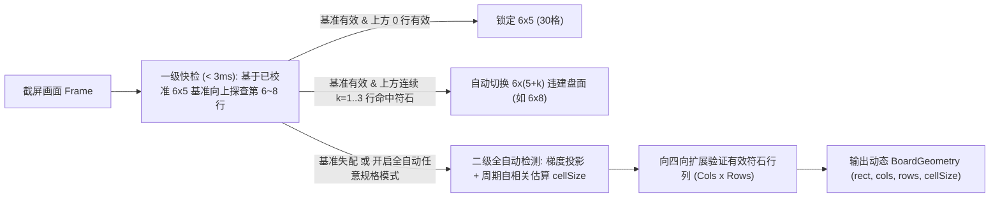
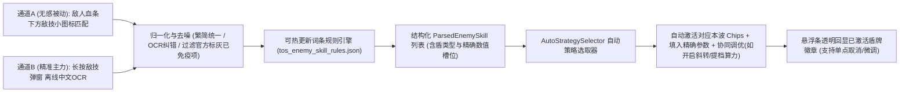
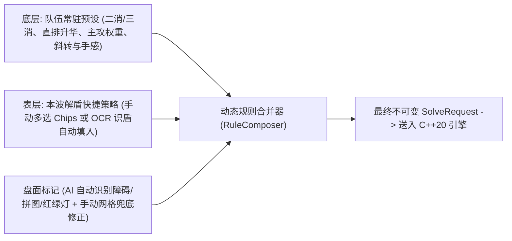
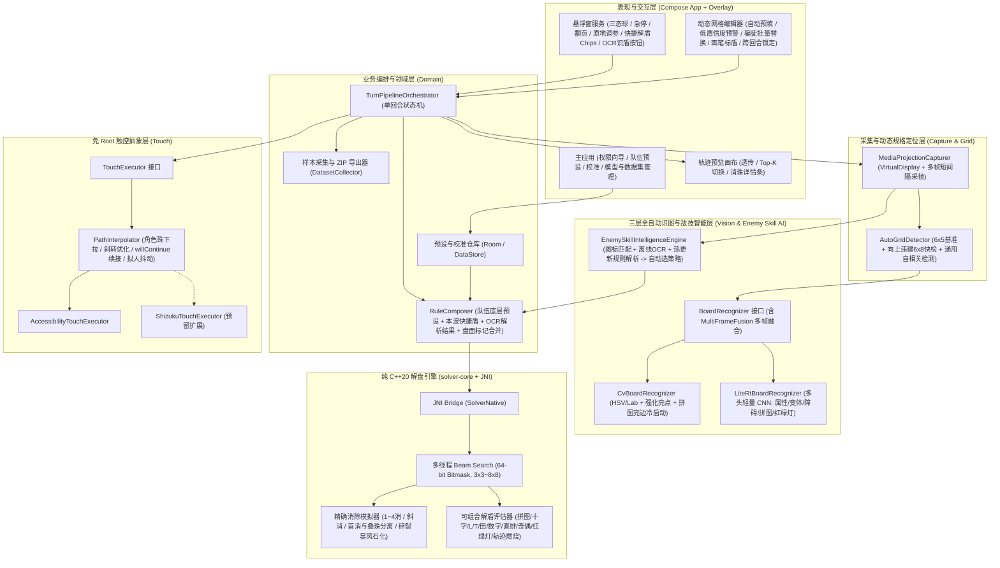

# AutoDora-NEXT v2.3 完整需求规格、神魔全机制矩阵与系统架构

> **项目定位**：面向《神魔之塔》（Tower of Saviors）13 年演进与 2026 现代版本及现代 Android 设备的**免 Root、全规格棋盘自适应、全自动识盘识盾与策略匹配、可组合解盾、问号/按珠变盘双模破局、端侧 AI 驱动**的新一代智能转珠辅助工具。
> **设计基线**：全面继承并升级旧版 [AutoDora-V3.4.3](./LEGACY_AUTODORA_ANALYSIS.md) 经实战验证的悬浮窗交互、调参与「问号‧转/风化‧转」按珠重算精华；完整对照 [《神魔之塔》13 年全机制全景调研手册](./TOS_COMPLETE_MECHANICS_CATALOG.md) 覆盖至 2026 年全部核心机制。
> **标定原则**：所有棋盘几何探测、校准基准与视觉色域/CNN 训练标定**一律严格基于真实《神魔之塔》游戏截图**，禁止使用合成 Mock 图作为标定依据。

---

## 1. 棋盘规格调研与「自动规格识别」设计

### 1.1 神魔之塔实际棋盘规格调研结论

经针对神魔之塔历史与最新版本（至 2026）机制核实，游戏内存在的盘面形态可分为三类：

| 规格类型 | 尺寸 (`Cols × Rows`) | 格数 | 触发场景与几何特征 |
| :--- | :--- | :---: | :--- |
| **标准盘面** | **`6 × 5`** | 30 | 游戏常态核心战斗盘面（6 直行 × 5 橫行）。 |
| **扩版盘面（俗称「违建」）** | **`6 × 8`**（主力）<br>兼容 `6 × 6` / `6 × 7` | 48 | 御五家主角主动技【界限突破】、合作角色（如天元突破「西蒙与螺岩」）、以及近代黑金/特色角色（如轩辕、舍脂、图灵与百慕达等**上滑角色头像触发「额外增加 3 行符石」**）。<br>**关键几何特征**：左右边界、底边与单格边长 `cellSize` **保持不变**，在标准 `6×5` 正上方直接**向上延伸 3 横行**（覆盖队伍栏/血条区域）。 |
| **等效缩盘 / 异形与通用规格** | **`4×4` ~ `8×8` 任意矩形**<br>+ **局部失效格掩码** | ≤ 64 | ① 战斗中被**暴风直行 / 碎裂区域 / 冰封封锁**导致有效活动区变小；<br>② 特殊活动关卡、教学/模拟盘面，或面向未来可能推出的 `7×6`、`5×4`、`6×6`、`8×6` 规格。 |

### 1.2 引擎底层：64-bit 原生动态规格支持

- C++20 解盘引擎**彻底取消硬编码 `6×5` 常量**，所有数据结构参数化为 `(cols, rows)`，支持 **`cols ∈ [3, 8], rows ∈ [3, 8]`（最大 64 格）**。
- 整盘空间掩码统一采用 **`uint64_t`（64-bit Bitmask）** 表示（风化、电击、暴风、碎裂、燃烧、拼图、红绿灯、失效格等）：无论是标准 `6×5`（30 格）、违建 `6×8`（48 格）还是 `7×6`（42 格）乃至 `8×8`（64 格），都能在单条 64-bit CPU 位指令内完成碰撞检测与状态判定，**零性能回退**！

### 1.3 视觉层：两级「自动识别格子规格」管线



1. **一级快检（血条锚定 + 违建秒切，耗时 < 3ms）**：
   - 基于神魔之塔在全面屏（如 20:9）将 16:9 战斗视口垂直居中的真实布局初始化基准 `6×5` 边界与 `cellSize`，并优先在 `base.topPx` 上方探测**绿色 HP 血条隔离带**：若检测到连续水平绿血条，则明确锁定为 `6×5` 盘面，**100% 杜绝将血条上方的 6 个彩色队伍角色头像误判为第 6 行 `[6×6 违建]`**；
   - 仅当未检测到绿血条隔离带且正上方 `topY - 1..3 * cellSize` 连续命中符石纹理与暗色棋盘底纹时，瞬间自动切换为 `6×6 / 6×7 / 6×8` 违建模式，切回普通回合自动恢复 `6×5`。
2. **二级全自动规格检测 + 可拖拽视觉校准框（全部以真实游戏截图为准）**：
   - 在画面中下区域计算 Sobel 水平/垂直边缘梯度投影，通过**自相关（Autocorrelation）主周期峰** + 血条上边界锚定自动测出真实 `cellSize` 与 `(cols, rows)`；
   - 校准模式支持**直接手拖四角/四边视觉框**贴合真实神魔棋盘边缘，同时保留像素级微调按钮。

---

## 2. 三层全自动识盘与识盾体系（全自动为主，手动网格兜底）

> **设计原则**：常态战斗 95% 场景无需手工点选改珠或标盾；系统通过「**多帧融合多头 AI 识盘** + **端侧离线 OCR 敌技弹窗一键识盾**」完成全自动识别，仅在物理不可见场景或低置信度预警时，自动拉起手动网格供 2 秒兜底修正并同步沉淀训练样本。

### 2.1 第一层：盘面内全要素自动识别（多帧融合 + 多头轻量 CNN）

针对神魔之塔中电击闪电、燃烧火焰、风化旋风、拼图光环、红绿灯均带有**闪烁动画特效**的特点，`MediaProjection` 在触发识图时连续取 **2~3 帧（总间隔约 150ms）** 进行帧间融合/投票，避免单帧落入特效暗帧导致漏判，随后通过动态 Batch (`Cols×Rows`) 的多头轻量 CNN 一次性输出：

1. **符石基础属性与变体**：水 / 火 / 木 / 光 / 暗 / 心、强化珠、**种族珠（圆环采样自动避让右上角种族黑白徽章区，独立识别种族标）**、弱化珠、**问号珠（`?` 专属识别，绝不误判水珠）**，以及**黑白珠**（训练阶段加入灰度/黑白数据增强，依赖符石内部纹样特征精准分类）。
2. **盘面障碍与异常状态（多标签输出）**：**风化、电击、冻结、冰封、石化、泡沫、燃烧、炼狱之火、黏腐、光牢、暴风、碎裂、化血、炸弹/熔焰焚爆、腐蚀、锁定（A未消惩罚/B消攻降）、弱化、枯藤、睡眠、流光符石、黑洞、问号珠 / 隐藏珠**。
3. **盘面几何标记自动抠图（`TileOverlayDetector`）**：
   - **拼图盾区域自动识别**：提取单元格四边亮边边框特征 + 多帧高亮融合 + AI `tile_puzzle` 输出头，自动抠出单拼图/双拼图目标掩码。
   - **红绿灯自动识别**：检测起手绿灯光圈（`tile_start`）与停手红灯光圈（`tile_end`），自动写入起终点约束。
4. **视觉遮蔽与按珠变盘双模破局引擎（`BoardMemory & Hold-and-Replan`）**：
   - **模式 A — 先露后藏记忆快照（Flash-Reveal Ring Buffer）**：针对进场/回合初短暂展示真实盘面后转为全版 `?` 问号珠或隐藏珠的关卡，零拷贝后台记忆环自动锁定翻面前的最后一张清晰真盘面，在透传画布上将真实属性**半透明透视叠画在 `?` 珠上**并直接送入 C++20 求解；
   - **模式 B — 免 Root「按珠显形‧即时重算模式（Hold-and-Replan）」**（升级旧版 AutoDora `问号‧转 / 风化‧转 / 烟雾` 模式）：针对必须先按住（或轻移 1 格）才能显形/刷出随机风化/触发变盘的关卡，`AccessibilityService` 先按住起手珠并用 `willContinue = true` 微心跳保活绝不抬手 → 等待可配置变盘延迟（250~500ms）→ 零拷贝抓取变盘后真实画面 + CV 识图 + 以当前按住格为 `fixedStartCell` 进行 C++20 急速重算（~60–100ms）→ 由同一根手指 `continueStroke()` 无缝接续滑完全程！

### 2.2 第二层：敌技自动识别、语义解析与策略自动选取引擎（`EnemySkillIntelligenceEngine`）

针对不会画在棋盘格内的规则型/复合型敌技（如 **7+ Combo 盾、恰好 6C、数字盾 20 颗、双十字盾、五属强化盾、反首消暗、首消全版、步数限制 15 步、奇偶盾、起结有序**），设计**双通道识盾 → 结构化语义解析 → 自动选取解盾策略**完整闭环：



1. **双通道自动识别输入**：
   - **通道 A — 无感图标被动识别（轻量辅助）**：常规识盘截屏时同步扫描画面上方敌人血条旁的敌技图标栏，通过轻量图标匹配自动提示/预选常见基础盾（五属盾、拼图盾、强化盾、Combo 盾等）。
   - **通道 B — 敌技弹窗离线 OCR 精准解析（核心主力）**：集成**端侧离线中文 OCR（如 Google ML Kit Chinese Text Recognition，零联网、< 80ms）**。战斗中长按敌人弹出官方敌技说明框后点击「识盾」（或可选自动侦测弹窗出现时抓取），读取全部复合敌技全文。
   - **官方三态色标智能过滤（适配 2025.41 / 2026.2 新 UI）**：结合神魔之塔官方敌技详情色标优化，识别 OCR 文本块颜色——对官方已标**灰色/半透明**（代表当前队伍技能已自带无视/免疫）的敌技条**自动跳过**，对**闪烁**（条件性无视）词条标记为可确认项，仅对正常高亮的有效敌技自动加盾，避免过度限制降低 Combo！
2. **可热更新的敌技词条解析引擎（`tos_enemy_skill_rules.json`）**：
   - 解析规则外置为结构化 JSON 词典（不写死在代码中），未来神魔推出新词条只需更新规则表即可秒适配，无需重编 APK。
   - 内置繁简归一（`連擊→连击`、`闇→暗`、`顆/粒`、`拼圖→拼图`）与 OCR 易混字纠错，抽取结构化槽位（如 `首消20粒 → ExactFirstWaveOrbCount(20)`、`禁首消暗 → ForbidFirstWave(DARK, CASCADE_STACK)`、`首批消除2个十字 → CrossShield(2)`、`步数限制15 → MaxSteps(15)`、`强化拼图盾 → PuzzleShield(enchanted=true)` 并自动与第一层抠出的拼图区域掩码绑定）。
3. **策略自动选取与透明回显（`AutoStrategySelector`）**：
   - **自动激活与覆盖**：自动勾选对应的本波快捷解盾 Chips 并填入精确参数；当敌技硬约束与底层队伍软偏好冲突时（例如底盘偏向消火，但本波敌技为反首消火），自动以本波敌技优先并切换为「叠珠绕过」。
   - **算力与斜转协同调优**：当自动识别到高难复合盾（如 `双十字 + 数字盾`、`严格拼图 + 红绿灯`）时，自动建议或临时启用斜转并提高 Beam Width 算力档位。
   - **透明可控不黑盒**：自动选中的全部盾牌策略以清晰徽章回显在悬浮条上方（如 `[自动识盾: 五属强化 | 反首消暗(叠珠) | 数字=20]`），玩家一眼确认、支持单点关闭或微调任意一项。

### 2.3 第三层：手动改珠与标盾网格的真正定位（兜底 + AI 进化飞轮）

以下 3 类物理像素不可见/未知场景，由悬浮动态网格作为极速兜底：
- **符石骗徒（伪装珠）**：支持网格内「一键批量替换伪装色」（如把全部假光珠批量覆写为真暗珠）。
- **隐藏珠 / 全屏问号珠**：配合「上回合盘面记忆缓存」+ 手动补全。
- **新版本全新特效/合作皮肤空窗期**：AI 自动将低置信度格子以黄色边框预警，用户点击修正确认时，**顺手将 30/48 格切片 + 真值标签写入本地采样集**，反哺端侧模型持续进化。

---

## 3. 全面继承并升级旧版 AutoDora 悬浮窗与交互精华

保留 [AutoDora-V3.4.3](./LEGACY_AUTODORA_ANALYSIS.md) 经老玩家验证的顺手交互，并用现代 Jetpack Compose + 免 Root 能力全面强化：

1. **三态主悬浮球**：待机 / 算路中（带进度环）/ 转珠中，自由拖动贴边吸附；长按快速折叠。
2. **游戏内原地悬浮调参面板（不切出游戏）**：悬浮条点击「调参」直接拉起半透明抽屉，支持：
   - **Tab 1：快捷解盾（本回合临时叠加 Chips + 「OCR 一键识盾」入口）**
   - **Tab 2：单属性精细规则（三元组矩阵）**
   - **Tab 3：神魔专属（昇华直排/角色珠/违建/轨迹燃烧）**
   - **Tab 4：队伍预设与算力/手感参数**
3. **Top-K 多候选路径左右翻页 + 消珠预览条**：
   - C++ 引擎单次搜索返回多条**差异化最优方案**（如 `#1 最高Combo / #2 最短步数 / #3 零风险解盾`）。
   - 悬浮条直接提供 `← / →` 切换预览路线，下方实时展示预计**首消 Combo / 总 Combo、步数、破盾达成灯号**，以及每组消除的**属性图标与颗数**。
4. **悬浮动态 `Cols×Rows` 改珠与标盾网格（自动预填 + 手动兜底修正）**：
   - 每次识图自动预填全部识别到的符石、异常状态、拼图框与红绿灯；低置信度格自动黄框高亮。
   - 支持**单点改色** + **画笔连涂模式** + **符石骗徒批量换色**。
   - **继承「跨回合锁定设定」开关**：多回合固定拼图盾、红绿灯或直行暴风只需确认/标一次，跨回合自动保留直到手动清除。
5. **安全控制与防翻车机制**：
   - **试跑确认模式（先画线、点执行再动）**、**移动前倒数（0~3 秒可选）**、**独立红色紧急急停按钮（立即中断无障碍手势链）**。
   - **原地盘面微调校准条**（上下左右位移 + 宽高微调 + 自动探测 + 规格切换 + 重置）。
   - **护眼模式 / 屏幕滤色器偏色检测提示** + **一键样本保存**（用户改珠确认时可选顺手存为 AI 训练样本）。

---

## 4. 截至 2026 神魔之塔全机制转珠与解盾参数体系

> **核心架构原则**：彻底消除旧版 C 引擎的规则互斥限制。所有规则抽象为**可自由组合的「硬性约束（Hard Constraints）」与「可调权重的目标评估项（Soft Objectives）」**，拼图盾 + 十字盾 + 数字盾 + 直排升华 + 避风化 + 红绿灯可任意同时叠加！

### 4.1 我方队伍、昇华与特殊转珠规则（Team & Player Mechanics）

| 类别 | 参数配置项 | 对应神魔之塔玩法与引擎行为 |
| :--- | :--- | :--- |
| **消除门檻与连结** | 每属性独立最低消除数：`1 / 2 / 3 / 4` 消（支持按属性单独二消）<br>**允许斜消（8 向相连消除）**开关<br>**跨色相连等效矩阵 `mergeElementMask[6]`**（如「水火相连即消」「心兼全属相连即消」） | 覆盖标准 3 消、二消神（火木/心二消）、四消条件、特殊一消/斜消及跨属性兼具连消队长技。与「**允许斜转（8 方向移动）**」独立解耦。 |
| **角色符石起手与地形** | `characterOrbCol: None / Col 1..6` + `characterElement` + `charOrbMustPassMask` / `charOrbMustEndOnMask` | 模拟从第 `c` 列队伍头像垂直下拉角色珠至 `(0, c)`：**① 下拉本身不计步数、② 免首格燃烧/走路痛、③ 不受常规结界地形限制、④ 触控层自动从头像区下拉衔接路径**；完整支持「角色符石通行/停放地形」与「起结有序-角色符石」敌技。 |
| **昇华技（直排/横排）** | **第 1~6 直行独立开关**：要求首消该直行 `3 / 4 / 5` 颗或整列全消（支持「加分」vs「必达」、限定属性或任意属性）<br>**横排强化**：指定某横行或任意整横排全消 | 完整覆盖神魔经典的**昇华剑 / 昇华心**直排触发与横排倍率队长技。 |
| **单属性精细三元组** | 6 属性（水/火/木/光/暗/心）各自独立：<br>1. **目标消法**：`任意 / 切3珠 / 2珠 / 4珠 / 5珠(强化全攻) / 6~9珠 / 横排 / 直排 / 十字 / L形 / T形 / 田字(2×2) / 全消`<br>2. **优先权三态循环**：`保留 ↔ 一般 ↔ 优先`<br>3. **消除时机**：`无限制 / 必须首消 / 禁首消(改叠珠) / 绝对禁消` | 继承旧版最高效的三元组设计，并扩展到全部现代形状（十字/L/T/田字）与「绝对禁消」。 |
| **边界与切珠策略** | **珠数不足时**：`消除` vs `保留`<br>**四珠以上策略**：`最高Combo / 消最多珠 / 消除一组`<br>**强制 3 珠切珠防黏连**开关<br>**强化珠 / 种族珠优先消除**开关 | 精准控制存珠、防大坨黏连降 C、保证强化珠/种族珠倍率触发。 |
| **排珠与违建模式** | **自由排珠 / 违建大步数模式**（步数上限扩展至 80~120 步）<br>常规步数滑杆（10~60 步） | 适配主角界限突破/黑金违建/妲己排珠等长耗时、大盘面场景。 |

### 4.2 现代神魔全系列敌技与盾牌支持矩阵（Enemy Shields & Hazards）

| 盾牌大类 | 具体敌技 / 盾牌 | 引擎参数化建模与求解策略 |
| :--- | :--- | :--- |
| **A. 连击类盾** | • 高 C 盾（`≥ N Combo`）<br>• 固定 / 连击相等盾（`== N Combo`，含首消或总计）<br>• 低 C / 零 Combo 盾（`≤ N` 或 `== 0`）<br>• **奇偶 Combo 盾**（首消奇/偶）<br>• **次批消除盾**（二波天降/叠珠消除条件）<br>• **同属连击（指定某属 ≥ K 组）**与 **双属 Combo 同等盾**（如首消光暗 C 数相等）<br>• 正负 Combo / 分水岭区间 `[minC, maxC]` | 严格区分 `firstWaveCombos`、`secondWaveCombos` 与 `totalCombos`；支持双属 `comboCount[a] == comboCount[b]`；针对 `== N` / 奇偶盾加入**防天降安全度评分**。 |
| **B. 数量与属性类盾** | • **数字盾**（首消总颗数 `== N` 或指定属性 `== N` / `≥ N`）<br>• **首消全版盾**与**首消全某属**（一颗不剩清光某属性）<br>• **累积消除盾**（单回合最大化指定属性消珠颗数）<br>• **五属 / 三属 / 四属 / 六色(含心) / 五属强化盾**与**符石种类盾（≥ K 种）**<br>• **纯属只消盾**（首消只可消指定属性，禁消其余属性）<br>• **反首消盾（叠珠解）** / **全禁消 / 心珠逆转** / **种族符石盾** | 评估器统计 `firstWaveEliminatedCount`、`remainingOfElement`、`distinctElements`、`eliminatedRaceMask` 与单属性最大颗数；反首消支持一键「**叠珠绕过**」或「**完全不消**」。 |
| **C. 几何形状类盾** | • **拼图盾（单拼图 / 双拼图）**：支持**严格不黏连（拼图-限）**、宽松全消、指定属性、**强化拼图**<br>• **十字盾（单十字 / 双十字 / 三十字，含十字-限）**<br>• **L 形 / T 形（含 -限）/ 田字（2×2）/ 直行整排 / 横行整列全消** | 对首消每个连通分量执行精确几何形状识别与外部同色黏连检测，支持 **2 组独立拼图掩码（`PUZZLE_1` / `PUZZLE_2`）**与多十字计数。 |
| **D. 特殊符石障碍** | • **禁触即停/即死**：**风化珠**、**电击珠**（禁碰+未消零伤）、**黏腐**、**连环光牢**、**炼狱之火（触碰即死，绝对硬禁入）**、**睡眠珠**<br>• **必须消除**：**化血珠**、**炸弹/熔焰焚爆**、**冻结（封前）**、**腐蚀**、**锁定A（未消扣血/引爆/回血）**、**枯藤**<br>• **不可直消/邻格解**：**冰封（3回合不可消）**、**石化（消四邻格逐层解）**、**泡沫（消四邻格全清）**、**碎裂（可穿不可消）**<br>• **避消与增益**：**弱化珠 / 锁定B（消则降攻）**、**流光符石（时光牌优先消）**、**黑白/问号/隐藏/伪装珠** | 严格区分「绝对禁入」「碰即停」「必消」「避消」「不可消」「邻格消除解层（石化/泡沫）」六大行为语义，全部在 64-bit 位掩码内零分配判定。 |
| **E. 地形、路径与操控干扰** | • **暴风区域**（禁碰+禁消）、**封界石阵**（区域禁消禁转）、**结界地型（2×2/3×4/围城：格内仅首消有效）**<br>• **灼热燃烧 / 瘴气地型**（触碰次数/累积上限）、**幻变空间**（经过时强转手中珠属性）<br>• **轨迹燃烧**、**轨迹腐蚀（最近 K 格自回避禁再碰）**、**轨迹转化（离开格变色）**<br>• **步数盾（≤ N / == N）**、**一步一伤**、**极速 2~3 秒转珠**<br>• **红绿灯 / 始终盾 / 单端起止点 / 角色珠通行与停放地型**<br>• **转珠方向逆转（上下/左右镜像）** | 搜索状态内置轨迹环形窗（轨迹燃烧/腐蚀）、幻变空间与轨迹转化动态改色、结界波次屏蔽与石阵禁消；`TouchExecutor` 原生支持**方向逆转一键镜像输出**与极速压缩步数模式。 |

### 4.3 搜索算力与执行控制参数

- **复杂度档位（Beam Width）**：`微(16) / 低(48) / 中(100) / 高(250) / 超(500) / 极(1000)` + 搜寻超时阈值（如 `300ms ~ 3000ms` 可调）。
- **求解策略模式**：`最快解（达成全部硬性解盾条件即早停）` vs `最佳解（在预算内搜寻最高综合分）`。
- **触控手感**：步间速度（ms/格）、斜转对角平滑加速、起止按压停顿、拟人微抖动、路径配色（高对比彩色 / 灰阶）。

---

## 5. 「两层叠加式」预置解盾策略快捷选取系统

神魔之塔实战中，**我方队伍机制整场固定，而敌方盾牌每波都在变（且常 2~4 个复合叠加）**。为避免每回合手调十几个参数，AutoDora-NEXT 采用**两层叠加架构**（且表层既可手动点击勾选，也可由 **OCR 识盾自动填充**）：



### 5.1 内置快捷解盾策略库（悬浮窗一键点选，打完该波一键「清空本波盾牌」）

1. **连击类快选**：`极限高C`、`恰好 5C`、`恰好 6C`、`恰好 7C`、`恰好 8C`、`首消奇C`、`首消偶C`、`纯首消(禁叠珠)`、`0C 空转`
2. **属性与数量快选**：`五属盾`、`五属强化盾`、`三属盾(水火木)`、`首消全版`、`数字盾(弹迷你数字盘点选 10~30)`、`反首消(点属性→自动叠珠)`、`禁消(点属性→绝不消)`、`全消指定色(如全心/全暗)`
3. **形状与拼图快选**：`严格拼图(不黏连+自动开画笔)`、`宽松拼图`、`强化拼图`、`单十字盾`、`双十字盾`、`三十字盾`、`L形`、`T形`、`田字(2×2)`、`一键全开 6 列直排昇华`
4. **障碍、变盘与路径快选**：`严避风化/暴风/炼狱火`、`强清电击/化血/炸弹/冻结/腐蚀`、`解石化/泡沫邻格`、`零踩燃烧/轨迹燃烧/轨迹腐蚀`、`问号记忆快照(先露后藏)`、`按珠显形即时重算(问号‧转/风化‧转/烟雾)`、`转珠方向逆转镜像`、`极速 2~3 秒转珠`、`红绿灯(点起终点)`、`角色珠起手与停放(点 1~6 号位)`、`限步数(快选 10/15/20 步)`、`一步一伤(极短步数)`
5. **高频复合套组（一键触发）**：
   - `五属强化 + 避风化`
   - `严格拼图 + 红绿灯`
   - `十字 + 数字盾（自动提档斜转高算力）`
   - `违建 6×8 爆发高C（自动放宽步数上限）`
   - `速刷最快解（低步数早停）`
6. **用户自订收藏**：支持把任意多选组合保存为个人快捷 Chip，置顶在悬浮窗首页。

---

## 6. 技术选型与系统总体架构

### 6.1 技术选型总览

| 模块 | 选型方案 | 说明 |
| :--- | :--- | :--- |
| **App 与 UI** | **Kotlin 2.x** + **Jetpack Compose (Material 3 紧凑高密度布局)** + 原生 `Canvas`（悬浮轨迹/拖拽校准框/网格） | 紧凑高 DPI 友好主界面 + 60/120fps 透传路径渲染；Hilt DI + Room（预设与采样元数据）+ DataStore |
| **核心解盘引擎** | **纯 C++20 (`solver-core`, CMake + Android NDK/JNI)** | 零 Android 依赖，PC 端直接运行完整单元测试与压测；原生 64-bit 位掩码支持任意 `3×3`~`8×8` 盘面 |
| **画面采集与网格检测** | **`MediaProjection` 常驻前台服务** + 多帧采样缓存 + C++/Kotlin 梯度自相关网格探测器 | 适配 Android 14/15+ `mediaProjection` 前台服务规范；自动侦测 `6×5` ↔ `6×8` 违建与任意规格，支持 2~3 帧短间隔融合防动态特效漏判 |
| **混合可插拔识图与识盾** | `BoardRecognizer` 接口：**传统 CV（冷启动 + 亮边拼图检测）** + **LiteRT (TFLite) 多头轻量 CNN** + **双通道敌技智能引擎（敌技图标匹配 + 端侧离线中文 OCR + 可热更新 JSON 词条解析与策略自动选取）** | 动态 Batch=`Cols×Rows` 一次推理完成每格「属性 + 强化/种族/黑白 + 障碍多标签 + 拼图/红绿灯」；双通道自动识别并解析敌技（支持跳过官方标灰已免疫词条），自动选取对应解盾策略 Chips 与协同算力参数；内置悬浮纠错采样与 `ml/` 训练管线 |
| **免 Root 触控抽象** | `TouchExecutor` 接口：**`AccessibilityService` (`dispatchGesture` + `willContinue` 续接)** + 预留 **Shizuku** 引擎 | 支持角色珠头向下拉起手、斜转对角加速平滑、长路径分段不断触、急停立即取消 |
| **目标系统** | **minSdk 29 (Android 10)** / **targetSdk 35 (Android 15)** | 覆盖绝大多数现代手机，纯本地离线运行零广告 |

### 6.2 分层组件架构



### 6.3 推荐 Monorepo 结构

```text
AutoDora-NEXT/
├── solver-core/                      # 纯 C++20 解盘引擎 (CMake，零 Android 依赖，支持任意 ≤8×8 盘面)
│   ├── include/autodora/             # board.hpp, rules.hpp, geometry.hpp, evaluator.hpp, solver.hpp
│   ├── src/                          # 消除模拟、形状/解盾评估、多线程 Beam Search、Top-K 多样性筛选
│   └── tests/                        # 单元测试与各盾牌专项回归集（6×5 & 6×8 违建 & 复合盾压测）
├── android/                          # Android 原生多模块工程 (Gradle Kotlin DSL)
│   ├── app/                          # Compose 主应用、悬浮窗、原地调参、快捷解盾 Chips、动态改珠画笔
│   ├── core-model/                   # 纯 Kotlin 领域模型 (BoardState, TeamBasePreset, WaveShieldRecipe)
│   ├── core-capture/                 # MediaProjection 多帧截屏 + 两级动态棋盘规格自动识别器
│   ├── core-vision/                  # BoardRecognizer、多帧融合、CV/LiteRT CNN、双通道敌技识别与自动策略匹配引擎
│   ├── core-touch/                   # TouchExecutor、无障碍手势执行器、角色珠/斜转插值、Shizuku 预留
│   ├── core-data/                    # Room (队伍预设/自订快捷策略/采样记录) + DataStore + 可热更新敌技规则 JSON
│   └── solver-jni/                   # JNI 桥接层 (链接顶层 solver-core)
├── ml/                               # 端侧多头轻量 CNN 训练与导出管线 (Python / PyTorch → LiteRT)
│   ├── tools/                        # 样本解压、切格校验、黑白/特效合成增强工具
│   ├── train/                        # 多头网络定义 (element / variant / hazards / tileOverlay / isRune)
│   └── export/                       # INT8/FP16 `.tflite` 量化导出与精度验证
└── docs/                             # 设计规范、敌技 OCR 词条规则表、解盾测试集格式、校准与模型训练手册
```

---

## 7. 分阶段研发路线图（4 阶段渐进交付）

| 阶段 | 核心交付内容 | 阶段验收标准 |
| :--- | :--- | :--- |
| **Phase 1：仓库骨架 + C++20 全能力解盘引擎（M1）** | 搭建 Monorepo；在 PC 端完成支持 **动态规格（`6×5`、`6×8` 违建、`7×6` 等，64-bit 掩码）** 的 C++20 引擎：1~4 消/斜消、单属性三元组（首消/叠珠/禁消）、直排昇华、角色珠起手、拼图盾（含双拼图/严格不黏连/强化）、十字/L/T/田字、数字盾、奇偶/同 C、风化/电击/暴风/碎裂/石化/化血/轨迹燃烧、红绿灯与 Top-K 返回，并建立完整单元测试套件。 | PC 端全部解盾回归测试 100% 通过；常规 `6×5` 300ms 内出 7~9+ C，复合盾与 `6×8` 违建 500~1000ms 内稳定出解。 |
| **Phase 2：免 Root 全链路 + 自动规格识别（M2）** | 打通 Android `MediaProjection` 零拷贝多帧截屏 + **两级动态规格自动识别（含 16:9 视口基准、绿血条锚定防头像误判与 `6×5` ↔ `6×8` 违建秒切、可拖拽视觉校准框）** + 传统 CV 六色/强化/问号/种族角标避让/拼图亮边冷启动 + **问号记忆快照 & 免 Root 按珠显形即时重算（Hold-and-Replan）** + 紧凑高密度首页 + 悬浮窗三态球/急停/路径预览/多路线翻页 + `AccessibilityService` 无障碍平滑自动转珠（含斜转、角色珠下拉与方向逆转镜像）。 | 在 PC 模拟器（`arm64-v8a` 官方转译）安装真实《神魔之塔》官方 APK，严格以真实游戏截图完成标定并跑通全链路闭环。 |
| **Phase 3：两层解盾快捷系统 + 敌技解析自动选策 + 动态兜底网格（M3）** | 上线**底层队伍预设 + 表层本波解盾快捷 Chips**、**双通道敌技识别与语义解析自动选策引擎**（离线中文 OCR 弹窗解析 + 可热更新 `tos_enemy_skill_rules.json` + 标灰已免疫过滤 + 自动匹配快捷策略与协同提档 + 悬浮条透明徽章回显）、游戏内原地悬浮调参面板、自动预填的动态改珠标盾网格（含画笔连涂、跨回合锁定与符石骗徒批量换色）与 Room 持久化。 | 面对复杂多盾 Boss，长按敌技弹窗点「识盾」即可自动识别解析并选中对应解盾策略与数值，透明回显且一键可微调。 |
| **Phase 4：端侧多头 AI 全自动识盘闭环 + Shizuku 扩展（M4）** | 上线 App 内一键纠错采样与 ZIP 导出、`ml/` 多头轻量 CNN 训练/多帧特效合成增强/LiteRT 导出管线、接入 `LiteRtBoardRecognizer`（全自动识别黑白珠、全障碍状态、拼图框、红绿灯）并支持热加载 `.tflite`；按需补齐 Shizuku 可选触控引擎。 | AI 模型配合多帧融合在强化、种族、风化、电击、燃烧、黑白、暴风、拼图框、红绿灯等复杂盘面上准确率 ≥ 98%，整盘推理 < 20ms。 |
