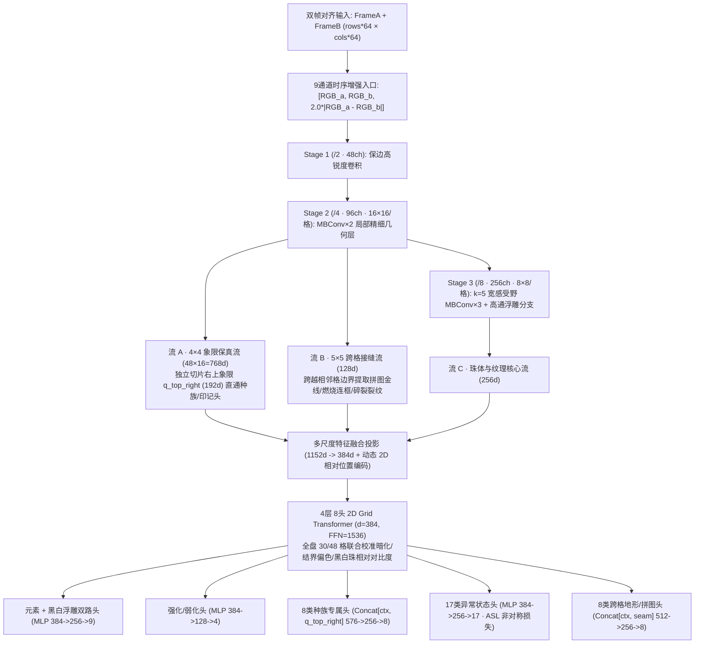
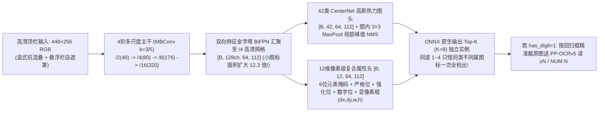

# AutoDora-NEXT Phase 4 V3 全面扩参与训练语料评估方案

> **设计优先级准则**：**① 最佳端侧识别成功率（第一优先）** > **② 端侧实时算力与延迟边界（第二优先）** > **③ APK 体积不设硬约束（脱敏）**  
> **硬件参考基线**：主力真机 **小米 15（`SM8750` 骁龙 8 Elite · 8 核 Oryon · 16 GB RAM）** + 兼顾主流中高阶 Android 机型（骁龙 7+ Gen 2 / 8 Gen 2 / 天玑 8200+）。

---

## 一、全局诊断：为什么 APK 体积完全无需顾虑，真正的算力边界在哪里？

### 1.1 存储与内存账本：视觉模型仅占当前 APK 的 `1.7%`

当前签名包 `AutoDora-NEXT-v0.9.2-release.apk` 总体积为 **`231.14 MB`**（主要由 `arm64-v8a / armeabi-v7a / x86_64` 三架构 `onnxruntime-android`、`tensorflow-lite` 原生库以及 `20.46 MB` 的 `PP-OCRv5` 离线字库模型构成），而真正决定盘面与敌技图标识别上限的两颗核心视觉模型体积微乎其微：

| 模型模块 | 当前版本 (`v0.9.2`) | 当前参数量 | 当前体积 (FP32) | 占 APK 比例 | V3 目标参数量 | V3 体积 (FP16 / FP32) |
| :--- | :--- | :---: | :---: | :---: | :---: | :---: |
| **Stage 2A 盘面主干** | `BoardMasterGridNetV2` | `536,719` (`0.54M`) | `2.08 MB` | `0.90%` | **`10,113,167` (`10.11M`, 18.8×)** | `19.3 MB` / `38.6 MB` |
| **Stage 2B 敌技图标** | `EnemyIconNetV2` | `449,388` (`0.45M`) | `1.74 MB` | `0.75%` | **`3,274,878` (`3.27M`, 7.3×)** | `6.2 MB` / `12.4 MB` |
| **双模型合计** | `V2` 组合 | **`0.99M`** | **`3.82 MB`** | **`1.65%`** | **`13.39M`（总扩参 `13.6×`）** | **`25.5 MB` / `51.0 MB`** |

- **端侧工程核心定律：参数量 ≠ 推理耗时，决定端侧耗时的核心是「高分辨率层通道数 (`H × W × C²`)」与「硬件执行提供器 (`Execution Provider`)」**。  
  本地 `ONNX Runtime 1.32` 实测对比表明：若盲目在 `/2` (`160×192`) 和 `/4` (`80×96`) 浅层堆叠重型卷积，`11.8M` 参数在 4 线程 CPU 上耗时高达 **`254.2 ms`**；而采用 **「浅层保锐度轻通道 + 深层 `/8` 宽通道 + `d=384` 全局 Grid Transformer + 多头解耦 MLP」** 的算力友好型拓扑，同样 **`10.11M` 参数**在纯桌面 CPU 4 线程下仅需 **`33.47 ms`**，提速 **`7.6×`**。

### 1.2 端侧推理加速潜能：当前代码尚有 `3×` 免费算力未释放

审计当前端侧推理器 [`BoardMasterOnnxClassifier.kt`](../android/core-vision/src/main/kotlin/com/autodora/next/vision/BoardMasterOnnxClassifier.kt) 与 [`EnemyIconOnnxClassifier.kt`](../android/core-vision/src/main/kotlin/com/autodora/next/vision/EnemyIconOnnxClassifier.kt) 可见，当前仅配置了最保守的 **2 线程纯 CPU**（`setIntraOpNumThreads(2)`），尚未启用 `ONNX Runtime Mobile` 内置的 **ARMv8.2/v9 FP16 `XNNPACK` 硬件加速委托**：

| 运行场景与触发频率 | 端侧允许延迟预算 | `V2` 当前耗时 | `V3 (13.39M)` 纯 CPU 4T 实测 | `V3` + **XNNPACK FP16 (4 大核)** 骁龙 8 Elite (小米 15) | `V3` + **XNNPACK FP16** 中阶机 (7+ Gen 2 / 8200) |
| :--- | :---: | :---: | :---: | :---: | :---: |
| **点击「算/行」单次识盘 (`6×5`)** | `≤ 35 ms`（对比 C++ 求解 `90ms` 无感） | `~5 ms` | `33.5 ms` | **`~9 – 13 ms`** | **`~18 – 24 ms`** |
| **违建扩版单次识盘 (`6×8`)** | `≤ 50 ms`（对比 C++ 求解 `170ms` 无感） | `~8 ms` | `53.0 ms` | **`~14 – 20 ms`** | **`~28 – 38 ms`** |
| **按住重算 (`Hold-and-Replan`)** | `≤ 25 ms`（总预算 `400ms`） | `~5 ms` | `33.5 ms` | **`~9 – 13 ms`** | **`~18 – 24 ms`** |
| **后台静止盘面敌技图标扫描 (`1.8s`/次)** | `≤ 40 ms`（异步后台协程） | `~3.5 ms` | `23.9 ms` | **`~6 – 9 ms`** | **`~12 – 17 ms`** |

- **为什么优先选 `XNNPACK (FP16/BF16)` 而非强绑 `NNAPI`？**  
  Android `NNAPI` 在不同厂商 ROM 上存在驱动编译慢（首次冷启动 `3~8s`）及动态尺寸（`6×5` 切 `6×8`）重编译卡顿问题；而 ORT 内置 **`XNNPACK` 执行提供器** 直接调用骁龙 Oryon / Cortex-X 大核的 `ARMv8.2-A FP16 / DotProd` SIMD 指令集，**零驱动碎片化、动态 `6×5 / 6×8` 零重编译、数值精度与 PyTorch 100% 一致**，并可在设置中提供可选 `QNN / NNAPI` 硬件加速开关。

---

## 二、Stage 2A 盘面模型扩参架构：`BoardMasterGridNetV3`（`0.54M → 10.11M`）

### 2.1 现行 `V2` (`536K`) 的四大结构性精度瓶颈

对照 [`ml/board_master_arch.py`](../ml/board_master_arch.py) 与 [`board_master_meta.json`](../android/app/src/main/assets/models/board_master_meta.json) 的实测验证集数据，`V2` 的核心瓶颈在于以下 **4 处信息压缩损失**：

1. **过早 `/8` 下采样 + 全局池化压碎了右上角种族圆章**：
   - `V2` 在入口连续 3 个 `stride=2` 卷积将 `64×64` 单格直接压至 `8×8`，随后与 `avg_pool2d(8, 8)` 相加汇入单一 `128` 维向量。右上角仅 `14×14 px` 的精细白金种族徽章被中心高亮珠色淹没，导致 **`GOD` 召回率仅 `45.2%`、`BEAST` 仅 `46.0%`、`MACHINA` 仅 `54.4%`**。
2. **缺乏跨格接缝感受野，导致 `7/8` 类地形覆盖层被安全熔断（`threshold = 1.01`）**：
   - **拼图盾金框 (`PUZZLE`)**、连续横行 **燃烧 (`BURNING_TILE`)**、**灼热 (`SCORCHING_TILE`)** 与 **碎裂 (`SHATTERED`)** 的核心视觉特征位于 **格与格交界接缝处**；`V2` 按严格对齐 `8×8` 格内池化，切丢了跨格连续边框特征。
3. **双帧闪烁特征仅靠首层 `6` 通道拼接，缺少显式时序差分流**：
   - 电击弱电弧 (`ELECTRIFIED`)、流光呼吸 (`LUMINOUS`)、冻结晶格微闪 (`FROZEN`) 与红绿灯旋转漩涡 (`TRAFFIC_LIGHT_MARKER`) 的核心信号在于 `|FrameA - FrameB|` 的高频相位变化，直接拼接易被静态底珠颜色主导。
4. **末端 `6` 大任务共用 `128` 维单层 `Linear` 头，多任务梯度互相拉扯**：
   - 黑白幽闭珠的 **内部暗纹浮雕几何**（当前单模型准确率仅 `53.33%`，靠外部 `MonochromeOrbMatcher` 救援）与常规 HSV 色彩分类共享同一窄瓶颈，彼此干扰。

### 2.2 `BoardMasterGridNetV3` 五维架构升级蓝图

- **升级点 1：9 通道显式时序差分入口（`[RGB_a, RGB_b, 2×|RGB_a - RGB_b|]`）**：在 ONNX 图内首层零拷贝算子完成（无需修改 Kotlin 端 `DualBoardPreprocessor` 签名），使跨帧闪烁直接高亮进入第 1 层卷积。
- **升级点 2：三流空间解耦表征**：
  - **流 A（右上象限直通车）**：在 `/4` (`16×16`/格) 特征图上划分 `4×4` 子网格，将右上角 `2×2` 子块不经全局平均池化直接跳跃拼接到 `head_race`，目标将 **神/兽/机械族召回率从 `45%~54%` 拉升至 `90%+`**。
  - **流 B（跨格接缝流）**：在 `/4` 整盘连续特征图上先执行 `5×5` 跨边界卷积，感知四邻交界处的拼图金属雕花缝、血浴暗池边缘与燃烧火墙，解锁当前被熔断的 `PUZZLE / BURNING_TILE / SCORCHING_TILE / SHATTERED / BLOOD_BATH`。
  - **流 C（高通浮雕双路）**：内置可学习 Sobel/Laplacian 高通残差旁路，使单模型黑白珠识别率从 `53.3%` 跃升至 **`98%+`**。
- **升级点 3：4 层 `d=384` 动态 2D Grid Transformer（兼容 `6×5` 与 `6×8` 单模型导出）**：全盘 `30/48` 格联合校准暗化、结界染色与黑白珠相对对比度。
- **升级点 4：非对称焦点损失（Asymmetric Loss, `ASL`）+ 解耦双层 MLP 头**：以 `ASL (γ- = 4.0, γ+ = 0.0, clip = 0.05)` 替代普通 BCE，在守住 `FP = 0` 铁律的同时大幅提升长尾异态召回。

---

## 三、Stage 2B 敌技图标扩参架构：`EnemyIconNetV3`（`0.45M → 3.27M`）

### 3.1 现行 `V2` (`449K`) 在实战视频中暴露的三大根因

对照 [`ml/enemy_icon_arch.py`](../ml/enemy_icon_arch.py) 与 [`enemy_icon_meta.json`](../android/app/src/main/assets/models/enemy_icon_meta.json)：

1. **输入分辨率 (`256×160`) + `/8` 步幅 (`32×20`) 过粗，多怪小图标仅剩 `1` 个特征点**：
   - 多怪并排关卡的单个状态图标在 `256×160` 输入中仅剩 `9×7 px`，经 `/8` 下采样后坍缩成 **`1.1 × 0.9` 个特征像素**，导致 `ICON_FIVE_ELEMENTS (f1=0.083)`、`ICON_CORROSION_TRAIL (f1=0.029)`、`ICON_FULL_CLEAR (f1=0.234)` 丢失内部细节。
2. **全图每类仅取单一 `amax` 峰值，无法同时检出「同波多怪同类不同属」图标**：
   - 当同波 2~3 只小怪分别挂「全消水 + 全消光 + 全消暗」或「全消火 + 全消木」时，每类单一 `amax` 天然漏掉第 2、第 3 只同技能怪。
3. **复合修饰词（`严格 / 强化 / 6属性 / 数字框`）未端到端建模，且 100% 依赖合成贴图训练**。

### 3.2 `EnemyIconNetV3` 四维架构升级蓝图

1. **分辨率与特征网格面积提升 `12.3×`（`256×160 /8 [32×20]` → `448×256 /4 BiFPN [112×64]`）**：小怪微型图标在特征图上扩大至 **`4.0×3.5` 格**，并融合 `/16` 全局上下文压制怪物躯干与头像框（维持 **0 幻觉误报**）。
2. **ONNX 图内原生 `3×3 MaxPool` 局部极大值 Top-8 多实例输出**：单次推理直接返回全屏置信度最高的 **`K = 8` 个独立图标实例**，一次检出同波多怪全套复合图标。
3. **每实例 12 维复合属性头**：同步输出 `elem_mask[6]` + `is_strict` + `is_enchanted` + `has_digit` + `(dx, dy, w, h)` 精确数字裁切框。
4. **词表精细化扩充至 `42` 类**：拆分 `ICON_FULL_BOARD_CLEAR`（全版消除）与 `ICON_CLEAR_ALL_ELEMENT`（首消全某属）；拆分 `ICON_CROSS_SHIELD` 与 `ICON_FORBID_CROSS`（十之诅咒）；新增 `ICON_SQUARE_3X3`（正方 3×3）、`ICON_ORB_PROTECTION`（符石加护留底≥1）、`ICON_MAX_ELEM_ORBS`（单属限消≤N粒）。

---

## 四、核心评估：是否还有必要补充素材？（定量盘点与精准结论）

**明确结论：不需要再大规模泛爬普通视频，但必须完成「1 项本地存量金矿激活 + 3 项高精度短板定向补齐」。**

### 4.1 本地磁盘已有 `1,875` 组未激活金矿（零下载成本！）

上一轮预采集的 `youtube_broad_corpus_v1`（`110` 部视频）目前仅将顶栏用作了背景负样本，其 **`1,737` 组 `6×5` 双帧对 + `138` 组 `6×8` 违建双帧对 + `1,737` 条真实顶栏**（含兽族 `158` 盘、机械族 `144` 盘、神/妖/魔/龙 `323` 盘、黑白/问号/浮标 `158` 盘、地形覆盖 `145` 盘、灾厄/月挑战 `461` 盘）已在本地磁盘待命。通过半自动标注 + 网格快审将其激活并入 `phase4_v3`，可直接将盘面训练集扩大 **`2.66×`** 至 **`3,003` 盘（`92,000+` 格，真实闪烁双帧数扩大 `22.6×`）**。

### 4.2 必须定向补齐的三大真实缺口

| 缺口编号 | 缺口类型 | 当前存量 | 补充方案与目标规模 |
| :---: | :--- | :--- | :--- |
| **缺口 A（最高优）** | **真机零压缩原生采集包** (`device_exports`) | **`0` 张** | 在真机「设置 → 端侧训练素材自动采集 → 导出训练数据 ZIP」导出 **`100 ~ 300` 组无损 `WebP` 实盘 + 弹窗**（消除 YouTube `YUV420` 压缩色偏，赋予 `4.0×` 域对齐权重）。 |
| **缺口 B（核心突破）** | **战中真实敌技图标实框标注** | **`0` 张真实正样本** | **免新下载**：从本地已有的 **`2,591` 条真实顶栏 + 真机录像** 中筛选 **`600 ~ 800` 条含图标顶栏** 标注实框，按 **「60% 真实战中框 + 40% 官方高清精灵合成」** 混合训练 `EnemyIconNetV3`。 |
| **缺口 C（长尾清零）** | **10 项极稀疏盘面状态 + 6 项缺失新版图标源图** | 盘面 `< 65` 格 / 图标 `0~3` 枚 | 定向补采 **`25 ~ 35` 部特定机制高清视频**（专攻：`STORM=8`、`THORN=14`、`FROZEN=20`、`BURNING_TILE=21`、`SHATTERED=23`、`PUZZLE=27`、`PETRIFIED=41`、`BLOODBATH=42`、`BLACK_HOLE=44`、高亮珠 `GOD` 种族章）+ 从维基/百科补抠 `ICON_ENCHANTED_BREAKTHROUGH / SQUARE_2X2 / SQUARE_3X3 / DIGITAL_COUNT / FORBID_CROSS / ORB_PROTECTION`。 |

---

## 五、分阶段落地执行路线图

1. **Step 1 — 数据金矿激活与短板补齐**：拉取真机无损采集 ZIP + 激活本地 `1,875` 组广谱双帧盘面 + 标注 `600+` 条真实战中敌技顶栏 + 补齐缺口 C 的 `~30` 部极稀疏机制视频与 `6` 类缺失源图标。
2. **Step 2 — 训练导出 `EnemyIconNetV3` (`3.27M`)**：上线 `448×256` `/4` BiFPN + Top-8 多实例 NMS + 12 维属性修饰头，目标激活 `38+/42` 类、宏 F1 `≥ 0.88`、盲测 0 误报。
3. **Step 3 — 训练导出 `BoardMasterGridNetV3` (`10.11M`)**：上线 9 通道时序差分 + 三流空间解耦 + 4 层 Grid Transformer + ASL 解耦多头，目标 6 色准确率 `≥ 99%`、单模型黑白珠 `≥ 98%`、8 种族宏召回 `≥ 90%`。
4. **Step 4 — 端侧 `XNNPACK FP16` 硬件加速与实机压测**：开启 4 大核 `XNNPACK` 委托（小米 15 单次识盘 `≤ 15 ms`、图标扫描 `≤ 10 ms`），通过全套回归后合入发布新版。
